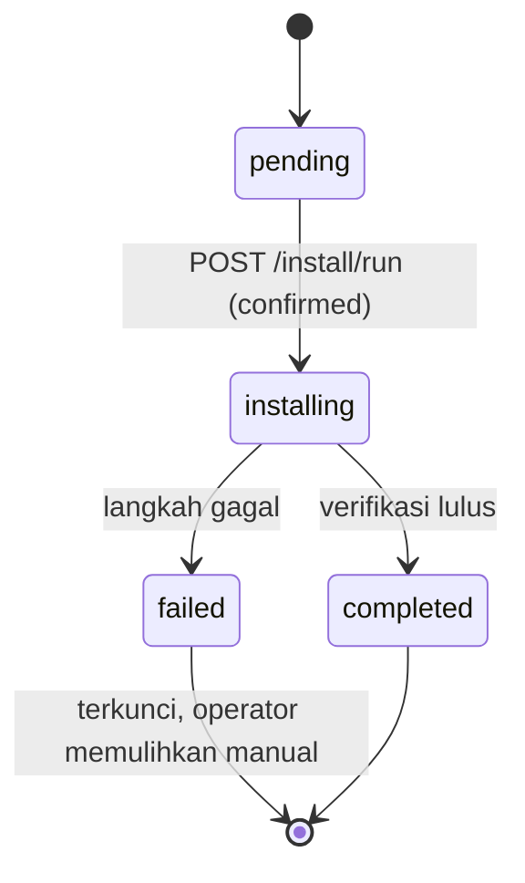

# Implementation Plan — INSTALLATION WIZARD

> **Project:** Website Resmi Paroki Hati Santa Perawan Maria Tak Bernoda (HSPMTB) Putussibau\
> **Fitur:** Installation Wizard (7 step)\
> **Status:** Implemented — engineering complete (branch `feat/installation-wizard`)\
> **Branch (usulan):** `feat/installation-wizard`\
> **Commit dasar (audit):** `main` @ `f502a57`\
> **Spesifikasi:** `docs/specifications/spec-installation-wizard.md` v1.0.0\
> **Sumber kebenaran:** `AGENTS.md` → `PRD.md` → `ARCHITECTURE.md` → `DECISIONS.md` → kode aktual

Dokumen spesifikasi menjelaskan _apa_ yang harus ada. Dokumen ini menjelaskan
_bagaimana_ perubahannya, dalam urutan apa, file mana yang tersentuh, dan bagaimana
diverifikasinya.

> Dokumen ini disusun setelah audit codebase terhadap kondisi repository saat ini
> dan **enam keputusan yang sudah dijawab pengguna** melalui tool `question`.
> Seluruh keputusan di §4 mengikat implementasi. Penyimpangan dari spesifikasi
> didaftar eksplisit di §4.2 dan wajib dicatat di `docs/DECISIONS.md` saat
> implementasi selesai.

---

## Daftar Isi

- [Implementation Plan — INSTALLATION WIZARD](#implementation-plan--installation-wizard)
  - [Daftar Isi](#daftar-isi)
  - [1. Ringkasan](#1-ringkasan)
  - [2. Kondisi Codebase Saat Ini](#2-kondisi-codebase-saat-ini)
    - [2.1 Runtime dan deployment](#21-runtime-dan-deployment)
    - [2.2 Seeder](#22-seeder)
    - [2.3 Site settings](#23-site-settings)
    - [2.4 Autentikasi dan role](#24-autentikasi-dan-role)
    - [2.5 Frontend](#25-frontend)
    - [2.6 Hasil verifikasi §19.2 spesifikasi](#26-hasil-verifikasi-192-spesifikasi)
  - [3. Ruang Lingkup](#3-ruang-lingkup)
    - [3.1 Termasuk](#31-termasuk)
    - [3.2 Tidak termasuk](#32-tidak-termasuk)
  - [4. Keputusan Implementasi (MENGIKAT)](#4-keputusan-implementasi-mengikat)
    - [4.1 Enam keputusan](#41-enam-keputusan)
    - [4.2 Deviasi dari spesifikasi](#42-deviasi-dari-spesifikasi)
  - [5. Arsitektur](#5-arsitektur)
    - [5.1 State machine dan file status](#51-state-machine-dan-file-status)
    - [5.2 Runtime sebelum migrasi](#52-runtime-sebelum-migrasi)
    - [5.3 Komponen backend](#53-komponen-backend)
    - [5.4 Komponen frontend](#54-komponen-frontend)
    - [5.5 Kontrak endpoint](#55-kontrak-endpoint)
    - [5.6 Session dan data wizard](#56-session-dan-data-wizard)
    - [5.7 Kode error dan pesan aman](#57-kode-error-dan-pesan-aman)
    - [5.8 Seeder dan verifikasi akhir](#58-seeder-dan-verifikasi-akhir)
  - [6. Implementation Plan per Fase](#6-implementation-plan-per-fase)
    - [Fase 0 — Audit (selesai)](#fase-0--audit-selesai)
    - [Fase 1 — Fondasi, guard, dan runtime](#fase-1--fondasi-guard-dan-runtime)
    - [Fase 2 — Requirements dan database](#fase-2--requirements-dan-database)
    - [Fase 3 — Input Super Admin dan identitas](#fase-3--input-super-admin-dan-identitas)
    - [Fase 4 — Runner, progress, dan completion](#fase-4--runner-progress-dan-completion)
    - [Fase 5 — Hardening dan aksesibilitas](#fase-5--hardening-dan-aksesibilitas)
    - [Fase 6 — Dokumentasi dan verifikasi akhir](#fase-6--dokumentasi-dan-verifikasi-akhir)
  - [7. File yang Terpengaruh](#7-file-yang-terpengaruh)
    - [7.1 Baru](#71-baru)
    - [7.2 Diubah](#72-diubah)
    - [7.3 Generated (jangan diedit manual)](#73-generated-jangan-diedit-manual)
    - [7.4 Tidak diubah](#74-tidak-diubah)
  - [8. Dampak Konfigurasi dan Dependency](#8-dampak-konfigurasi-dan-dependency)
    - [8.1 Environment](#81-environment)
    - [8.2 Composer / NPM](#82-composer--npm)
    - [8.3 Gate dan commit](#83-gate-dan-commit)
  - [9. Risiko dan Mitigasi](#9-risiko-dan-mitigasi)
  - [10. Verification Plan](#10-verification-plan)
    - [10.1 Test otomatis](#101-test-otomatis)
    - [10.2 Manual QA (menggantikan E2E)](#102-manual-qa-menggantikan-e2e)
    - [10.3 Perintah verifikasi](#103-perintah-verifikasi)
  - [11. Acceptance Criteria](#11-acceptance-criteria)
    - [11.1 Fungsional](#111-fungsional)
    - [11.2 Keamanan](#112-keamanan)
    - [11.3 UX](#113-ux)
    - [11.4 Operasional](#114-operasional)
  - [12. Pertanyaan / Ambiguity](#12-pertanyaan--ambiguity)
  - [13. Status](#13-status)

---

## 1. Ringkasan

Installation Wizard adalah alur onboarding satu kali yang memeriksa persyaratan
server, menguji koneksi database, mengumpulkan akun Super Admin dan identitas
paroki, menjalankan migrasi + seeder produksi terpilih, lalu memverifikasi hasil
dan mengunci installer.

Tujuh step:

1. Welcome
2. System Requirements
3. Database Configuration (verifikasi koneksi dan kelayakan)
4. Super Admin Setup
5. Application Configuration (identitas paroki)
6. Review dan Install
7. Installation Complete

**Masalah teknis utama yang harus diselesaikan lebih dulu:** aplikasi ini belum
dapat melayani request HTTP sebelum migrasi, karena `.env.example` memakai
`SESSION_DRIVER=database`, `CACHE_STORE=database`, dan `QUEUE_CONNECTION=database`,
sementara `HandleInertiaRequests` membaca `site_settings` pada setiap request
Inertia. Rencana ini menambahkan lapisan runtime khusus installer agar wizard
dapat hidup di atas database yang masih kosong, tanpa mengubah driver untuk
request normal setelah instalasi selesai.

---

## 2. Kondisi Codebase Saat Ini

Audit dilakukan pada branch `main`. Tidak ada file kode yang diubah saat audit.

### 2.1 Runtime dan deployment

| Area                | Kondisi aktual                                                                                                                 | File                                                           |
| ------------------- | ------------------------------------------------------------------------------------------------------------------------------ | -------------------------------------------------------------- |
| Driver session      | `SESSION_DRIVER=database`                                                                                                      | `.env.example:50`                                              |
| Driver cache        | `CACHE_STORE=database`                                                                                                         | `.env.example:73`                                              |
| Driver queue        | `QUEUE_CONNECTION=database`                                                                                                    | `.env.example:61`                                              |
| Default DB          | `env('DB_CONNECTION', 'sqlite')`; MySQL adalah target proyek                                                                   | `config/database.php:20,47`                                    |
| Setup awal          | `composer setup` menjalankan `migrate --force`                                                                                 | `composer.json:48-56`                                          |
| Middleware web      | `HandleAppearance`, `HandleInertiaRequests`, `AddLinkHeadersForPreloadedAssets`, `AssignRequestId`, `BlockWritesDuringRestore` | `bootstrap/app.php:26-32`                                      |
| Shared props        | `share()` menyentuh `site_settings` lewat closure `seo`, `identity`, `contact`                                                 | `app/Http/Middleware/HandleInertiaRequests.php:82,133,165,258` |
| Restore guard       | `BlockWritesDuringRestore` memakai `Cache` pada request non-GET                                                                | `app/Http/Middleware/BlockWritesDuringRestore.php:25`          |
| Perintah destruktif | `DB::prohibitDestructiveCommands(app()->isProduction())`                                                                       | `app/Providers/AppServiceProvider.php:122`                     |
| Disk lokal          | Root `storage/app/private`, `serve => true`, visibility private (butuh signed URL)                                             | `config/filesystems.php:33-38`                                 |
| Storage link        | Dibuat oleh `composer setup`; tidak otomatis oleh wizard                                                                       | `composer.json:53`                                             |

**Implikasi:** membuka `/install` pada database kosong saat ini akan gagal pada
tabel `sessions`/`cache` sebelum kode wizard dieksekusi. Ini bukan bug yang bisa
diabaikan; ini prasyarat arsitektur.

### 2.2 Seeder

| Seeder                    | Perilaku aktual                                                                                                | Kesimpulan                                                                                      |
| ------------------------- | -------------------------------------------------------------------------------------------------------------- | ----------------------------------------------------------------------------------------------- |
| `PermissionSeeder`        | `Role::findOrCreate(AppServiceProvider::SUPER_ADMIN)`, `Permission::findOrCreate`, `forgetCachedPermissions()` | Aman dijalankan ulang; membuat role `super_admin`                                               |
| `PostCategorySeeder`      | `updateOrCreate` per slug                                                                                      | Idempoten, tetapi menimpa rename admin                                                          |
| `EventCategorySeeder`     | `updateOrCreate` per slug                                                                                      | Idempoten, tetapi menimpa rename admin                                                          |
| `ServiceCategorySeeder`   | `withTrashed()->firstOrCreate` per slug                                                                        | Idempoten, tidak menimpa                                                                        |
| `DocumentCategorySeeder`  | `firstOrCreate` per slug                                                                                       | Idempoten, tidak menimpa                                                                        |
| `CommunityCategorySeeder` | `withTrashed()->updateOrCreate`, deskripsi `"Contoh kategori komunitas untuk pratinjau."`                      | **Menimpa editan dan memasukkan teks demo** — diperbaiki                                        |
| `SuperAdminSeeder`        | `seedSuperAdmin()` publik; `firstOrNew` + `forceFill` + `syncRoles`                                            | Dapat dipakai ulang; **menimpa password** bila email sudah ada, sehingga wajib dijaga pemanggil |
| `SiteSettingsSeeder`      | `firstOrCreate` 2 nilai                                                                                        | Tidak dipanggil wizard                                                                          |
| `ServiceSeeder`           | Membuat 7 layanan + media dummy                                                                                | Tidak dipanggil wizard                                                                          |
| `DemoContentSeeder`       | Guard `config('demo.enabled')`, default `DEMO_SEED=true`                                                       | Tidak dipanggil wizard                                                                          |
| `DatabaseSeeder`          | Memanggil seluruh seeder di atas                                                                               | Tidak dipanggil wizard                                                                          |

### 2.3 Site settings

| Area                       | Kondisi aktual                                                                     | File                                           |
| -------------------------- | ---------------------------------------------------------------------------------- | ---------------------------------------------- |
| Key yang dibutuhkan wizard | `parish_name`, `parish_short_name`, `tagline`, `short_description`, `patron_saint` | `config/site-settings.php:59-69`               |
| API tulis                  | `setMany(array)` memfilter `knownKeys()`, satu transaksi, lalu `forget()` cache    | `app/Services/SiteSettingsService.php:101,131` |
| Nilai kosong               | `null` disimpan sebagai `null`; string kosong disimpan sebagai `''`                | `app/Services/SiteSettingsService.php:218-226` |
| Cache                      | Satu key `site_settings`, TTL 86400, invalidasi eksplisit                          | `config/site-settings.php:44-47`               |

Keputusan: field opsional yang kosong dikirim sebagai `null`, bukan `''` dan
bukan string `"null"`.

### 2.4 Autentikasi dan role

| Area                        | Kondisi aktual                                                               | File                                              |
| --------------------------- | ---------------------------------------------------------------------------- | ------------------------------------------------- |
| Role Super Admin            | `AppServiceProvider::SUPER_ADMIN = 'super_admin'`                            | `app/Providers/AppServiceProvider.php:22`         |
| Guard                       | `config('auth.defaults.guard')` = `web`                                      | `database/seeders/PermissionSeeder.php:294-302`   |
| Route login                 | `login` → `/admin/login` (Fortify prefix `admin`)                            | `config/fortify.php:95`                           |
| Middleware admin            | `auth`, `verified`, `EnsureAccountIsActive`, `EnsureAdminAccess`             | `routes/web.php:133-134`                          |
| Super Admin lolos otorisasi | `Gate::before` mengembalikan `true` untuk role `super_admin`                 | `app/Providers/AppServiceProvider.php:110`        |
| Password production         | `Password::defaults()`: min 12, mixed case, angka, simbol, `uncompromised()` | `app/Providers/AppServiceProvider.php:126-132`    |
| Password non-production     | `Password::min(8)`                                                           | `Illuminate\Validation\Rules\Password::default()` |

`SuperAdminSeeder::seedSuperAdmin()` sudah menetapkan `is_active`, `email_verified_at`,
dan role. Karena route admin memakai middleware `verified`, akun buatan wizard
harus terverifikasi — seeder ini memenuhinya.

### 2.5 Frontend

| Area           | Kondisi aktual                                                   | File                                                         |
| -------------- | ---------------------------------------------------------------- | ------------------------------------------------------------ |
| Lokasi halaman | `resources/js/features/<audience>/<feature>/pages/`              | `app/Support/PageChunk.php`                                  |
| Nama halaman   | Path di bawah `pages/`, `index.tsx` = fitur itu sendiri          | `app/Support/PageChunk.php`                                  |
| Layout         | Dipilih by-name di `app.tsx`; default `AppLayout`                | `resources/js/app.tsx:63-79`                                 |
| Layout auth    | Split layout dengan branding paroki, foto `/auth-section.webp`   | `resources/js/layouts/auth/components/auth-split-layout.tsx` |
| Komponen form  | `Field`, `FormLabel`, `FormInput`, `FormTextarea`, `FormActions` | `resources/js/components/form-fields.tsx`                    |
| Password input | Toggle show/hide, `aria-label`, keyboard-operable                | `resources/js/components/password-input.tsx`                 |
| Error          | `AlertError`, `input-error`                                      | `resources/js/components/alert-error.tsx`                    |
| Route helper   | Wayfinder; jangan hard-code URL                                  | `resources/js/routes/`, `resources/js/actions/`              |
| Unit test      | Vitest, `tests/js/**`, happy-dom                                 | `vite.config.ts`, `tests/js/`                                |

Konsekuensi: struktur `resources/js/pages/installation/*.tsx` di spesifikasi §8.2
**tidak dapat dipakai apa adanya**. Halaman ditempatkan di
`resources/js/features/installation/wizard/pages/` dengan nama Inertia
`installation/wizard/...`, dan `app.tsx` mendapat case layout baru.

### 2.6 Hasil verifikasi §19.2 spesifikasi

| #   | Item yang diminta                | Hasil                                                                                                                                  |
| --- | -------------------------------- | -------------------------------------------------------------------------------------------------------------------------------------- |
| 1   | Nama class dan namespace seeder  | Semua ada di `Database\Seeders`; tidak ada class yang hilang                                                                           |
| 2   | Idempotensi seeder               | Lihat §2.2; `CommunityCategorySeeder` perlu diperbaiki                                                                                 |
| 3   | Definisi role Super Admin        | `AppServiceProvider::SUPER_ADMIN`, guard `web`                                                                                         |
| 4   | API `SiteSettingsService`        | `setMany()` + cache invalidation tersedia                                                                                              |
| 5   | Ekstensi PHP wajib               | Framework: `ctype, filter, hash, mbstring, openssl, session, tokenizer`; aplikasi: `pdo_mysql, gd, zip, fileinfo`; `curl` = peringatan |
| 6   | Driver DB yang didukung          | MySQL 8 saja (`mysql`); `mariadb` ada di config tetapi tidak diuji                                                                     |
| 7   | Cara konfigurasi `.env`          | Tidak ada penulis `.env`; deployment-managed (keputusan §4)                                                                            |
| 8   | Route login admin                | `login` → `/admin/login`                                                                                                               |
| 9   | Strategi proses panjang          | Sinkron + polling (keputusan §4)                                                                                                       |
| 10  | Bootstrap status sebelum migrasi | File JSON (keputusan §4)                                                                                                               |
| 11  | Kebijakan backup                 | Belum ada; wizard menampilkan peringatan dan tidak membuat backup otomatis                                                             |

---

## 3. Ruang Lingkup

### 3.1 Termasuk

- Pemeriksaan persyaratan server yang read-only.
- Verifikasi koneksi database dan kelayakannya sebagai instalasi baru.
- Form Super Admin dan identitas paroki dengan validasi server.
- Migrasi normal dan seeder produksi terpilih.
- Pembuatan Super Admin dengan role yang benar.
- Penyimpanan 5 identitas paroki melalui `SiteSettingsService`.
- Verifikasi hasil sebelum menyatakan sukses.
- Pencatatan status, progress, dan kegagalan yang aman.
- Penguncian installer setelah sukses.
- Test unit, feature, dan integration.
- Dokumentasi deployment dan pemulihan.

### 3.2 Tidak termasuk

- Menulis atau mengubah `.env` dari browser.
- Tabel `installation_status` di database.
- Resume otomatis setelah kegagalan.
- Menjalankan instalasi di background/queue.
- Playwright E2E pada iterasi ini.
- Backup otomatis sebelum instalasi.
- Import konten dari website lama.
- Seeder demo, `ServiceSeeder`, `SiteSettingsSeeder`, `SuperAdminSeeder` berbasis env.
- Panel pengaturan ulang/reinstall.
- Driver selain MySQL.

---

## 4. Keputusan Implementasi (MENGIKAT)

### 4.1 Enam keputusan

| #   | Topik                     | Keputusan                                                                                                | Alasan                                                                                                                                                             |
| --- | ------------------------- | -------------------------------------------------------------------------------------------------------- | ------------------------------------------------------------------------------------------------------------------------------------------------------------------ |
| K-1 | Konfigurasi environment   | **Deployment-managed.** Operator menyiapkan `.env`; wizard hanya menguji dan menampilkan nilai read-only | Menghindari tulis `.env` dari web, masalah permission, escaping, dan config cache basi. Cocok dengan alur deployment repo (SSH + `composer install` + `npm build`) |
| K-2 | Status instalasi          | **File state machine** di `storage/app/private/installation/status.json`                                 | Satu-satunya sumber yang sudah bekerja sebelum tabel apa pun ada; mudah diperiksa operator; tidak menyimpan secret                                                 |
| K-3 | Eksekusi                  | **Sinkron satu request** + `GET /install/progress` untuk polling                                         | Tidak bergantung pada queue worker yang belum bisa berjalan sebelum migrasi                                                                                        |
| K-4 | Readiness & recovery      | **Hanya database 0 tabel.** Status `failed` terkunci; pemulihan manual                                   | Fail closed, tidak ada operasi destruktif otomatis                                                                                                                 |
| K-5 | E2E                       | **Feature/integration test + manual QA**                                                                 | CI tetap cepat; E2E membutuhkan database instalasi khusus                                                                                                          |
| K-6 | `CommunityCategorySeeder` | **Diperbaiki**: hapus deskripsi contoh, `firstOrCreate`                                                  | Menghilangkan konten "contoh" dari produksi dan mencegah penimpaan editan admin                                                                                    |

### 4.2 Deviasi dari spesifikasi

| Spesifikasi                                                 | Implementasi                                                          | Alasan                                               |
| ----------------------------------------------------------- | --------------------------------------------------------------------- | ---------------------------------------------------- |
| §6.3 Step 3 mengumpulkan host/port/name/user/password       | Panel read-only + tombol **Uji Koneksi**; kredensial diubah di `.env` | K-1; wizard tidak menulis `.env`                     |
| §6.5.2 Step 5 mengubah nama aplikasi, URL, timezone, locale | Ditampilkan read-only di Step 5/6                                     | K-1; nilai berasal dari environment dan config cache |
| §9.1 status di tabel `installation_status`                  | File JSON state machine                                               | K-2; tabel belum ada sebelum migrasi                 |
| §6.6 "evaluasi job/background"                              | Sinkron + polling, `set_time_limit(300)`                              | K-3; queue database baru tersedia setelah migrasi    |
| §13.3 resume `failed → installing`                          | Tidak ada resume otomatis; instruksi operator                         | K-4                                                  |
| §16.4 E2E Playwright                                        | Manual QA terstruktur                                                 | K-5                                                  |
| §6.6 tombol final "Install Now"                             | Label **"Pasang Sekarang"**                                           | UI berbahasa Indonesia                               |

Semua deviasi di atas wajib dicatat di `docs/DECISIONS.md` (D-90 … D-95) dan
tidak boleh menambah operasi destruktif.

---

## 5. Arsitektur

### 5.1 State machine dan file status



**Lokasi:** `storage/app/private/installation/status.json`\
**Lock:** `Cache::lock('installation.run', 3600)`; status `installing` menjadi penjaga persisten\
**Direktori:** dibuat saat pertama dibutuhkan, permission `0700`, file `0600`.

**Skema file (tidak berisi secret):**

```json
{
  "version": 1,
  "status": "pending",
  "current_step": null,
  "started_at": null,
  "completed_at": null,
  "failed_at": null,
  "error_code": null
}
```

**Nilai `current_step`:**

| Nilai              | Label UI                       |
| ------------------ | ------------------------------ |
| `validate`         | Memvalidasi konfigurasi        |
| `migrate`          | Menjalankan migrasi            |
| `seed_permissions` | Menyiapkan role dan permission |
| `seed_categories`  | Menyiapkan kategori awal       |
| `create_admin`     | Membuat akun Super Admin       |
| `save_settings`    | Menyimpan identitas paroki     |
| `verify`           | Memverifikasi instalasi        |
| `lock`             | Mengunci installer             |

**Aturan tulis:**

- Tulis atomik: file sementara di direktori yang sama → `fwrite` → `rename`.
- Tidak ada penulisan dari input browser selain lewat service.
- File hilang = `pending`, tetapi kelayakan database tetap diperiksa ulang.
- Transisi hanya boleh: `pending → installing`, `installing → completed|failed`.
- `completed` dan `failed` bersifat terminal untuk endpoint HTTP.
- Reset status bukan fitur HTTP; operator menghapus file melalui SSH setelah
  verifikasi manual.

**Penanganan proses yang mati:**

- Jika status `installing` dan lock masih ada, `POST /install/run` mengembalikan
  `409`. UI menampilkan `started_at` dan instruksi pemeriksaan.
- Lock cache memiliki TTL 1 jam. Status `installing` yang menggantung dipulihkan
  operator dengan menghapus file status setelah memastikan tidak ada proses
  berjalan.

### 5.2 Runtime sebelum migrasi

Tiga perubahan yang membuat installer dapat berjalan di atas database kosong:

1. **`UseInstallerRuntime`** — middleware global yang di-_prepend_ di
   `bootstrap/app.php`. Untuk `install` dan `install/*` saja:

   ```php
   config([
       'session.driver' => 'file',
       'cache.default'  => 'file',
       'queue.default'  => 'sync',
   ]);
   ```

   Dijalankan sebelum `StartSession`, sehingga session tetap bekerja tanpa tabel
   `sessions`. Request normal setelah instalasi tetap memakai driver dari `.env`.

2. **`HandleInertiaRequests::share()`** — short-circuit untuk path installer:
   kembalikan `parent::share($request)` + `name` saja. `errors` dan `flash` tetap
   tersedia untuk validasi Inertia; `seo`, `identity`, `contact`, dan `abilities`
   yang menyentuh database tidak dievaluasi.

3. **Layout installer mandiri** — tidak memakai `PublicLayout`/`AppLayout` yang
   membaca shared props hasil query.

`BlockWritesDuringRestore` aman karena cache sudah dipaksa `file` sebelum
middleware web berjalan.

### 5.3 Komponen backend

```text
app/
├── Http/
│   ├── Controllers/Installation/
│   │   ├── InstallationWizardController.php
│   │   └── InstallationRunController.php
│   ├── Middleware/
│   │   ├── EnsureInstallerAvailable.php
│   │   └── UseInstallerRuntime.php
│   └── Requests/Installation/
│       ├── StoreSuperAdminSetupRequest.php
│       ├── StoreApplicationConfigurationRequest.php
│       └── RunInstallationRequest.php
└── Services/Installation/
    ├── InstallationState.php
    ├── SystemRequirementsChecker.php
    ├── DatabaseConnectionTester.php
    ├── DatabaseReadinessChecker.php
    ├── ProductionSeederRunner.php
    ├── InstallationRunner.php
    └── InstallationVerifier.php
```

| Komponen                       | Tanggung jawab                                                   | Tidak boleh                                  |
| ------------------------------ | ---------------------------------------------------------------- | -------------------------------------------- |
| `InstallationWizardController` | Menampilkan step, validasi input non-final, menyimpan ke session | Menulis database                             |
| `InstallationRunController`    | Menerima konfirmasi, menjalankan runner, progress, completion    | Menerima status dari browser                 |
| `InstallationState`            | Baca/tulis state atomik, lock, transisi                          | Menyimpan secret                             |
| `SystemRequirementsChecker`    | Pemeriksaan server read-only                                     | Menyentuh database                           |
| `DatabaseConnectionTester`     | Uji koneksi dengan connection sementara                          | Menjalankan migrasi, mencatat password       |
| `DatabaseReadinessChecker`     | Memutuskan 0 tabel = layak                                       | Menganggap "tabel status tidak ada" = kosong |
| `ProductionSeederRunner`       | Menjalankan hanya seeder dari config                             | Memanggil `DatabaseSeeder`/demo              |
| `InstallationRunner`           | Orkestrasi urutan + error mapping                                | `migrate:fresh`, `db:wipe`, `DROP TABLE`     |
| `InstallationVerifier`         | Memeriksa hasil akhir                                            | Menetapkan `completed` sendiri               |

### 5.4 Komponen frontend

```text
resources/js/
├── layouts/installation/
│   ├── index.tsx
│   └── components/step-indicator.tsx
└── features/installation/wizard/
    ├── pages/
    │   ├── index.tsx          # Step 1
    │   ├── requirements.tsx   # Step 2
    │   ├── database.tsx       # Step 3
    │   ├── super-admin.tsx    # Step 4
    │   ├── application.tsx    # Step 5
    │   ├── review.tsx         # Step 6
    │   └── complete.tsx       # Step 7
    ├── components/
    │   ├── requirement-row.tsx
    │   ├── connection-status.tsx
    │   ├── review-summary.tsx
    │   ├── progress-list.tsx
    │   └── error-panel.tsx
    ├── lib/csrf.ts
    └── types.ts
```

Nama Inertia: `installation/wizard`, `installation/wizard/requirements`, dst.
`app.tsx` mendapat case:

```ts
case name.startsWith('installation/'):
    return InstallationLayout;
```

Komponen yang dipakai ulang: `Button`, `Field`, `FormLabel`, `FormInput`,
`FormTextarea`, `PasswordInput`, `AlertError`, `Text`, `ParishLogo`.

### 5.5 Kontrak endpoint

| Method | URI                             | Nama route                     | Fungsi                         | Menulis DB |
| ------ | ------------------------------- | ------------------------------ | ------------------------------ | ---------- |
| GET    | `/install`                      | `install.show`                 | Step 1 / redirect sesuai state | Tidak      |
| GET    | `/install/requirements`         | `install.requirements`         | Step 2                         | Tidak      |
| POST   | `/install/requirements/check`   | `install.requirements.check`   | Periksa ulang                  | Tidak      |
| GET    | `/install/database`             | `install.database`             | Step 3                         | Tidak      |
| POST   | `/install/database/test`        | `install.database.test`        | Uji koneksi + readiness        | Tidak      |
| GET    | `/install/super-admin`          | `install.super-admin`          | Step 4                         | Tidak      |
| POST   | `/install/super-admin/validate` | `install.super-admin.validate` | Validasi + simpan session      | Tidak      |
| GET    | `/install/application`          | `install.application`          | Step 5                         | Tidak      |
| POST   | `/install/application/validate` | `install.application.validate` | Validasi + simpan session      | Tidak      |
| GET    | `/install/review`               | `install.review`               | Ringkasan + konfirmasi         | Tidak      |
| POST   | `/install/run`                  | `install.run`                  | Eksekusi instalasi             | **Ya**     |
| GET    | `/install/progress`             | `install.progress`             | Status proses (JSON)           | Tidak      |
| GET    | `/install/complete`             | `install.complete`             | Step 7                         | Tidak      |

**Middleware:** `web` (CSRF) + `EnsureInstallerAvailable`.

**Rate limit:**

| Endpoint                             | Limit                 |
| ------------------------------------ | --------------------- |
| `POST /install/database/test`        | `throttle:10,1`       |
| `POST /install/requirements/check`   | `throttle:30,1`       |
| `POST /install/super-admin/validate` | `throttle:30,1`       |
| `POST /install/application/validate` | `throttle:30,1`       |
| `POST /install/run`                  | `throttle:5,1` + lock |
| `GET /install/progress`              | `throttle:120,1`      |

**Payload `POST /install/run`:**

```json
{ "confirmed": true }
```

**Respons `POST /install/run`:**

| Situasi                 | Status | Body                                                     |
| ----------------------- | ------ | -------------------------------------------------------- |
| Sukses                  | `200`  | `{"status":"completed"}`                                 |
| Gagal terkontrol        | `200`  | `{"status":"failed","error_code":"MIGRATION_FAILED"}`    |
| Konfirmasi tidak ada    | `422`  | `{"message":"Konfirmasi diperlukan."}`                   |
| Sudah selesai / lock    | `409`  | `{"status":"completed"}` atau `{"status":"installing"}`  |
| Requirements tidak siap | `503`  | `{"status":"failed","error_code":"REQUIREMENTS_FAILED"}` |

**Respons `GET /install/progress`:**

```json
{
  "status": "installing",
  "current_step": "migrate",
  "started_at": "2026-10-28T08:00:00Z",
  "completed_at": null,
  "failed_at": null,
  "error_code": null
}
```

Tidak pernah mengembalikan stack trace, query, path sensitif, atau konfigurasi.

**Perilaku guard:**

- `INSTALLER_ENABLED=false` → `404` untuk semua route installer.
- Status `completed` → GET diarahkan ke `/admin/login`; POST `409`.
- Status `failed` → hanya halaman status + instruksi; `run` ditolak `409`.
- Status `installing` → halaman review menampilkan progress, bukan form.
- Step yang belum memenuhi prasyarat → redirect ke step yang kurang.
- Step 6 tidak pernah menjalankan apa pun lewat GET.
- Step 7 hanya dirender bila state `completed` **dan** session memiliki
  `installation.completed_notice`.

### 5.6 Session dan data wizard

| Key                                 | Isi                                        | Umur                     |
| ----------------------------------- | ------------------------------------------ | ------------------------ |
| `installation.database_verified_at` | Timestamp uji koneksi + readiness berhasil | Sampai run               |
| `installation.super_admin`          | `name`, `email`, `password`                | Sampai run selesai/gagal |
| `installation.application`          | 5 field identitas                          | Sampai run selesai       |
| `installation.completed_notice`     | `true`                                     | Sekali tampil Step 7     |

- Password hanya berada di session server-side (file driver, permission ketat),
  tidak pernah dikirim balik ke browser, tidak masuk log, tidak masuk URL.
- Setelah run (sukses atau gagal), `password` dihapus dari session.
- Session habis → validasi ulang meminta input sensitif; tidak ada data sensitif
  di local storage.
- Payload aplikasi hanya 5 key; `SiteSettingsService` juga memfilter key asing
  sebagai pertahanan berlapis.

### 5.7 Kode error dan pesan aman

| Kode                   | Penyebab                             | Pesan UI                                                                                     |
| ---------------------- | ------------------------------------ | -------------------------------------------------------------------------------------------- |
| `REQUIREMENTS_FAILED`  | Pemeriksaan wajib gagal              | "Persyaratan server belum terpenuhi. Perbaiki item yang ditandai lalu periksa ulang."        |
| `DATABASE_UNREACHABLE` | Koneksi gagal (host/auth/unknown DB) | "Database tidak dapat dijangkau atau kredensial ditolak. Periksa konfigurasi `.env`."        |
| `DATABASE_NOT_FRESH`   | Ada tabel di database target         | "Database target sudah berisi tabel. Gunakan database baru atau lakukan pemeriksaan manual." |
| `DATABASE_UNSUPPORTED` | Driver bukan MySQL                   | "Driver database tidak didukung installer."                                                  |
| `INSTALL_LOCKED`       | Lock/status `installing`             | "Proses instalasi lain sedang berjalan. Periksa status dan log server."                      |
| `MIGRATION_FAILED`     | Migrasi melempar exception           | "Migrasi database gagal. Periksa log server dan status migrasi sebelum mencoba lagi."        |
| `SEEDER_FAILED`        | Seeder gagal                         | "Penyiapan data awal gagal. Periksa log server; jangan mengulang tanpa memeriksa database."  |
| `ADMIN_EMAIL_TAKEN`    | Email sudah ada                      | "Email tersebut sudah digunakan akun lain."                                                  |
| `ADMIN_CREATE_FAILED`  | Pembuatan user gagal                 | "Akun Super Admin gagal dibuat. Instalasi tidak diselesaikan."                               |
| `SETTINGS_FAILED`      | Penyimpanan identitas gagal          | "Identitas paroki gagal disimpan. Instalasi tidak diselesaikan."                             |
| `VERIFICATION_FAILED`  | Verifikasi pasca-instalasi gagal     | "Verifikasi instalasi gagal. Jangan gunakan aplikasi sebelum diperiksa operator."            |

Log server mencatat: step, kode, durasi, class exception, dan pesan exception.
Tidak mencatat password, connection string, atau payload sensitif.

### 5.8 Seeder dan verifikasi akhir

**Seeder yang dijalankan, berurutan:**

1. `PermissionSeeder` (wajib lebih dulu; membuat role `super_admin`)
2. `PostCategorySeeder`
3. `EventCategorySeeder`
4. `ServiceCategorySeeder`
5. `DocumentCategorySeeder`
6. `CommunityCategorySeeder`

Dijalankan satu per satu lewat `Artisan::call('db:seed', ['--class' => ..., '--force' => true])`.

**Tidak dijalankan:** `SuperAdminSeeder` (env), `SiteSettingsSeeder`, `ServiceSeeder`,
`DemoContentSeeder` dan turunannya, `DatabaseSeeder`.

**Pembuatan Super Admin:**

- Assert `User::where('email', $email)->doesntExist()`; jika ada →
  `ADMIN_EMAIL_TAKEN` (tidak pernah menimpa).
- Panggil `SuperAdminSeeder::seedSuperAdmin($name, $email, $password)` agar
  password policy, `is_active`, `email_verified_at`, dan role konsisten dengan
  jalur seeding yang sudah ada.

**`InstallationVerifier` memeriksa:**

1. Tidak ada migrasi pending (file migrasi vs repository `Ran`).
2. Role `super_admin` ada dengan guard yang benar.
3. User admin ada, memiliki role, `is_active=true`, `email_verified_at != null`.
4. `parish_name` dan `parish_short_name` terbaca non-kosong lewat
   `SiteSettingsService` (membuktikan cache ter-invalidasi).
5. Tidak ada user demo `redaksi-demo@example.test`.
6. `Route::has('login')` benar.

Jika salah satu gagal, status tetap `installing` → `failed` dengan
`VERIFICATION_FAILED`; `completed` tidak ditulis.

---

## 6. Implementation Plan per Fase

### Fase 0 — Audit (selesai)

**Hasil:** §2 dokumen ini. Tidak ada perubahan kode.

**DoD:** seluruh item §19.2 terjawab dan risiko utama terdokumentasi.

---

### Fase 1 — Fondasi, guard, dan runtime

**Tujuan:** installer dapat dibuka di database kosong dan tidak dapat diakses
saat nonaktif/selesai.

| ID      | Task                                                                  | File                                                                                                      |
| ------- | --------------------------------------------------------------------- | --------------------------------------------------------------------------------------------------------- |
| IW-1.1  | Tambah config installer                                               | `config/installer.php` (baru)                                                                             |
| IW-1.2  | Tambah flag `INSTALLER_ENABLED=false` + komentar                      | `.env.example`                                                                                            |
| IW-1.3  | Buat `InstallationState` (baca, tulis atomik, transisi, lock, status) | `app/Services/Installation/InstallationState.php`                                                         |
| IW-1.4  | Buat `EnsureInstallerAvailable`                                       | `app/Http/Middleware/EnsureInstallerAvailable.php`                                                        |
| IW-1.5  | Buat `UseInstallerRuntime` dan daftarkan sebagai prepend              | `app/Http/Middleware/UseInstallerRuntime.php`, `bootstrap/app.php`                                        |
| IW-1.6  | Short-circuit shared props installer                                  | `app/Http/Middleware/HandleInertiaRequests.php`                                                           |
| IW-1.7  | Daftarkan 13 route installer                                          | `routes/web.php`                                                                                          |
| IW-1.8  | Buat layout installer + step indicator                                | `resources/js/layouts/installation/**`                                                                    |
| IW-1.9  | Tambah case layout                                                    | `resources/js/app.tsx`                                                                                    |
| IW-1.10 | Halaman Step 1 (welcome)                                              | `resources/js/features/installation/wizard/pages/index.tsx`                                               |
| IW-1.11 | Test guard + state                                                    | `tests/Unit/Installation/InstallationStateTest.php`, `tests/Feature/Installation/InstallerAccessTest.php` |

**Isi `config/installer.php` (kunci):**

```php
return [
    'enabled' => (bool) env('INSTALLER_ENABLED', false),
    'status_path' => storage_path('app/private/installation/status.json'),
    'lock_key' => 'installation.run',
    'lock_seconds' => 3600,
    'database' => ['supported_drivers' => ['mysql']],
    'requirements' => [
        'php' => '8.3.0',
        'extensions' => ['pdo', 'pdo_mysql', 'gd', 'zip', 'fileinfo', 'mbstring', 'openssl', 'ctype', 'filter', 'hash', 'session', 'tokenizer'],
        'warnings' => ['curl'],
    ],
    'seeders' => [
        Database\Seeders\PermissionSeeder::class,
        Database\Seeders\PostCategorySeeder::class,
        Database\Seeders\EventCategorySeeder::class,
        Database\Seeders\ServiceCategorySeeder::class,
        Database\Seeders\DocumentCategorySeeder::class,
        Database\Seeders\CommunityCategorySeeder::class,
    ],
    'role' => App\Providers\AppServiceProvider::SUPER_ADMIN,
];
```

**DoD:**

- `/install` menampilkan Step 1 pada database kosong, termasuk saat
  `SESSION_DRIVER=database` dan `CACHE_STORE=database`.
- `INSTALLER_ENABLED=false` → 404 untuk seluruh route.
- Status `completed` → GET redirect login, POST 409.
- State machine unit test lulus; file korup → fail closed.

---

### Fase 2 — Requirements dan database

**Tujuan:** memastikan server siap dan database layak sebelum input apa pun.

| ID     | Task                                                   | File                                                                                                       |
| ------ | ------------------------------------------------------ | ---------------------------------------------------------------------------------------------------------- |
| IW-2.1 | Buat `SystemRequirementsChecker`                       | `app/Services/Installation/SystemRequirementsChecker.php`                                                  |
| IW-2.2 | Buat `DatabaseConnectionTester` (connection sementara) | `app/Services/Installation/DatabaseConnectionTester.php`                                                   |
| IW-2.3 | Buat `DatabaseReadinessChecker` (0 tabel)              | `app/Services/Installation/DatabaseReadinessChecker.php`                                                   |
| IW-2.4 | Controller step 1–3 + aksi recheck/test                | `app/Http/Controllers/Installation/InstallationWizardController.php`                                       |
| IW-2.5 | Halaman Step 2                                         | `.../pages/requirements.tsx` + `requirement-row.tsx`                                                       |
| IW-2.6 | Halaman Step 3                                         | `.../pages/database.tsx` + `connection-status.tsx`                                                         |
| IW-2.7 | Test requirements & readiness                          | `tests/Unit/Installation/*`, `tests/Feature/Installation/RequirementsStepTest.php`, `DatabaseStepTest.php` |

**Daftar pemeriksaan requirements:**

| Pemeriksaan                                                     | Status bila gagal | Aksi yang ditampilkan             |
| --------------------------------------------------------------- | ----------------- | --------------------------------- |
| PHP ≥ 8.3                                                       | gagal             | "Tingkatkan versi PHP."           |
| Ekstensi wajib                                                  | gagal             | Daftar ekstensi yang hilang       |
| `APP_KEY` terisi                                                | gagal             | `php artisan key:generate`        |
| `storage` & `bootstrap/cache` writable                          | gagal             | Perbaiki permission               |
| Asset frontend (`public/build/manifest.json` atau `public/hot`) | gagal             | `npm run build`                   |
| `public/storage` symlink                                        | peringatan        | `php artisan storage:link`        |
| `max_execution_time` 0 atau ≥ 120                               | peringatan        | Naikkan batas waktu               |
| `APP_ENV=production` + `APP_DEBUG=true`                         | peringatan        | Matikan debug                     |
| `APP_URL` absolut http(s)                                       | gagal             | Perbaiki `.env`                   |
| `DB_CONNECTION` didukung                                        | gagal             | Gunakan `mysql`                   |
| Ekstensi `curl`                                                 | peringatan        | Informasi untuk `uncompromised()` |

**Database tester:**

- Membuat connection runtime `installer-probe` dari
  `config('database.connections.'.config('database.default'))`.
- `DB::purge('installer-probe')` setelah dipakai.
- Error dipetakan ke kode aman; pesan mentah hanya ke log.
- Tidak pernah menampilkan password atau connection string.

**Readiness:**

- `Schema::connection('installer-probe')->getTableListing()` (normalisasi nama
  tabel untuk MySQL).
- `0 tabel` → lulus. `>0` → `DATABASE_NOT_FRESH` dengan jumlah tabel saja.
- Tidak menggunakan tabel `installation_status` sebagai indikator.

**DoD:**

- Step 2 dan 3 selesai pada database kosong.
- `POST /install/database/test` sukses → redirect Step 4 dan set
  `installation.database_verified_at`.
- Database berisi tabel → ditolak, tidak ada migrasi.
- Requirements endpoint tetap 200 walau koneksi database mati.

---

### Fase 3 — Input Super Admin dan identitas

**Tujuan:** mengumpulkan data final tanpa menyentuh database.

| ID     | Task                                        | File                                                                           |
| ------ | ------------------------------------------- | ------------------------------------------------------------------------------ |
| IW-3.1 | Buat `StoreSuperAdminSetupRequest`          | `app/Http/Requests/Installation/StoreSuperAdminSetupRequest.php`               |
| IW-3.2 | Buat `StoreApplicationConfigurationRequest` | `app/Http/Requests/Installation/StoreApplicationConfigurationRequest.php`      |
| IW-3.3 | Aksi validasi + simpan session              | `InstallationWizardController`                                                 |
| IW-3.4 | Halaman Step 4                              | `.../pages/super-admin.tsx`                                                    |
| IW-3.5 | Halaman Step 5                              | `.../pages/application.tsx`                                                    |
| IW-3.6 | Halaman Step 6 review                       | `.../pages/review.tsx` + `review-summary.tsx`                                  |
| IW-3.7 | Test validasi & session                     | `tests/Feature/Installation/SuperAdminStepTest.php`, `ApplicationStepTest.php` |

**Aturan Super Admin:**

| Field                   | Aturan                                                  |
| ----------------------- | ------------------------------------------------------- |
| `name`                  | `required`, `string`, `max:100`                         |
| `email`                 | `required`, `email`, `max:255`, dinormalisasi lowercase |
| `password`              | `required`, `confirmed`, `Password::defaults()`         |
| `password_confirmation` | Wajib sama                                              |

- Tidak ada pilihan role.
- Password tidak pernah dikirim balik dalam props; halaman hanya menampilkan
  nama dan email saat kembali.
- Indikator kekuatan password boleh ada, tetapi server tetap sumber kebenaran.

**Aturan identitas paroki:**

| Field               | Aturan                          | Kosong  |
| ------------------- | ------------------------------- | ------- |
| `parish_name`       | `required`, `string`, `max:150` | ditolak |
| `parish_short_name` | `required`, `string`, `max:50`  | ditolak |
| `tagline`           | `nullable`, `string`, `max:150` | `null`  |
| `short_description` | `nullable`, `string`, `max:500` | `null`  |
| `patron_saint`      | `nullable`, `string`, `max:100` | `null`  |

- Trim semua input.
- Key di luar daftar ditolak; controller hanya mengambil 5 key.
- Nilai diambil dari `config()` untuk nama aplikasi, URL, timezone, locale dan
  ditampilkan read-only.

**DoD:**

- Belum ada user/setting yang dibuat.
- Validasi 422 untuk input salah.
- Kembali antar-step mempertahankan input non-sensitif.
- Session tidak pernah mengirim password ke browser.

---

### Fase 4 — Runner, progress, dan completion

**Tujuan:** instalasi nyata, aman, terverifikasi, dan terkunci.

| ID     | Task                               | File                                                                          |
| ------ | ---------------------------------- | ----------------------------------------------------------------------------- |
| IW-4.1 | Perbaiki `CommunityCategorySeeder` | `database/seeders/CommunityCategorySeeder.php`                                |
| IW-4.2 | Buat `ProductionSeederRunner`      | `app/Services/Installation/ProductionSeederRunner.php`                        |
| IW-4.3 | Buat `InstallationVerifier`        | `app/Services/Installation/InstallationVerifier.php`                          |
| IW-4.4 | Buat `InstallationRunner`          | `app/Services/Installation/InstallationRunner.php`                            |
| IW-4.5 | Buat `RunInstallationRequest`      | `app/Http/Requests/Installation/RunInstallationRequest.php`                   |
| IW-4.6 | Buat `InstallationRunController`   | `app/Http/Controllers/Installation/InstallationRunController.php`             |
| IW-4.7 | Progress list + polling            | `.../components/progress-list.tsx`, `.../lib/csrf.ts`                         |
| IW-4.8 | Halaman Step 7                     | `.../pages/complete.tsx`                                                      |
| IW-4.9 | Test runner                        | `tests/Feature/Installation/InstallationRunTest.php`, `InstallerLockTest.php` |

**Urutan `InstallationRunner`:**

1. Validasi state `pending` dan ambil lock.
2. Set `installing`, `started_at`, `current_step=validate`.
3. Periksa ulang requirements dan readiness (0 tabel).
4. `current_step=migrate` → `Artisan::call('migrate', ['--force' => true])`.
5. `current_step=seed_permissions` → `PermissionSeeder`.
6. `current_step=seed_categories` → 5 seeder kategori.
7. `current_step=create_admin` → cek email, `seedSuperAdmin()`.
8. `current_step=save_settings` → `setMany()` 5 key.
9. `current_step=verify` → `InstallationVerifier`.
10. `current_step=lock` → tulis `completed`, `completed_at`, set
    `installation.completed_notice`, hapus password dari session, lepas lock.
11. Gagal di langkah mana pun → `failed`, `error_code`, `failed_at`, log aman,
    lepas lock.

**Batasan runtime:**

- `set_time_limit(300)` di awal run.
- `DB::prohibitDestructiveCommands` tetap aktif; wizard tidak memanggil perintah
  destruktif.
- Tidak ada `migrate:fresh`, `db:wipe`, `DROP TABLE`, atau `truncate`.

**DoD:**

- Database kosong → aplikasi terverifikasi, login admin berhasil, 5 setting
  terbaca, kategori dan role ada, tidak ada konten demo.
- Request kedua → 409; tidak ada duplikasi user/kategori.
- Kegagalan seeder/verifikasi → status `failed`, bukan `completed`.
- Installer terkunci setelah sukses.

---

### Fase 5 — Hardening dan aksesibilitas

| ID     | Task             | Detail                                                                                 |
| ------ | ---------------- | -------------------------------------------------------------------------------------- |
| IW-5.1 | Rate limit       | Terpasang di route sesuai §5.5                                                         |
| IW-5.2 | Error mapping    | Semua jalur gagal memakai kode §5.7, tanpa stack trace                                 |
| IW-5.3 | Logging          | Step, durasi, kode; tanpa secret                                                       |
| IW-5.4 | Responsif        | Satu kolom < `lg`; tanpa horizontal overflow                                           |
| IW-5.5 | Aksesibilitas    | Label, `aria-describedby`, focus state, `aria-live` progress, status bukan hanya warna |
| IW-5.6 | State UI         | Loading, valid, error, testing, gagal, running, failed, completed, locked              |
| IW-5.7 | Konfirmasi final | Checkbox "database baru" + tombol "Pasang Sekarang"                                    |

**DoD:**

- Keyboard-only dapat menyelesaikan seluruh step.
- Progress terbaca screen reader.
- Tidak ada informasi sensitif di UI/response.

---

### Fase 6 — Dokumentasi dan verifikasi akhir

| ID     | Task                                 | File                                         |
| ------ | ------------------------------------ | -------------------------------------------- |
| IW-6.1 | Catat 6 keputusan + deviasi          | `docs/DECISIONS.md` (D-90 … D-95)            |
| IW-6.2 | Bagian **Instalasi baru**            | `docs/DEVELOPMENT.md` (bagian baru)          |
| IW-6.3 | Bagian **Pemulihan instalasi gagal** | `docs/DEVELOPMENT.md` (bagian baru)          |
| IW-6.4 | Regenerasi Wayfinder                 | `php artisan wayfinder:generate --with-form` |
| IW-6.5 | Gate penuh                           | `npm run check`, `composer ci:check`         |
| IW-6.6 | Manual QA                            | Checklist §10.2                              |

**DoD:** seluruh acceptance criteria §11 terpenuhi dan terdokumentasi.

---

## 7. File yang Terpengaruh

### 7.1 Baru

**Backend**

- `config/installer.php`
- `app/Http/Middleware/EnsureInstallerAvailable.php`
- `app/Http/Middleware/UseInstallerRuntime.php`
- `app/Http/Controllers/Installation/InstallationWizardController.php`
- `app/Http/Controllers/Installation/InstallationRunController.php`
- `app/Http/Requests/Installation/StoreSuperAdminSetupRequest.php`
- `app/Http/Requests/Installation/StoreApplicationConfigurationRequest.php`
- `app/Http/Requests/Installation/RunInstallationRequest.php`
- `app/Services/Installation/InstallationState.php`
- `app/Services/Installation/SystemRequirementsChecker.php`
- `app/Services/Installation/DatabaseConnectionTester.php`
- `app/Services/Installation/DatabaseReadinessChecker.php`
- `app/Services/Installation/ProductionSeederRunner.php`
- `app/Services/Installation/InstallationRunner.php`
- `app/Services/Installation/InstallationVerifier.php`

**Frontend**

- `resources/js/layouts/installation/index.tsx`
- `resources/js/layouts/installation/components/step-indicator.tsx`
- `resources/js/features/installation/wizard/pages/index.tsx`
- `resources/js/features/installation/wizard/pages/requirements.tsx`
- `resources/js/features/installation/wizard/pages/database.tsx`
- `resources/js/features/installation/wizard/pages/super-admin.tsx`
- `resources/js/features/installation/wizard/pages/application.tsx`
- `resources/js/features/installation/wizard/pages/review.tsx`
- `resources/js/features/installation/wizard/pages/complete.tsx`
- `resources/js/features/installation/wizard/components/requirement-row.tsx`
- `resources/js/features/installation/wizard/components/connection-status.tsx`
- `resources/js/features/installation/wizard/components/review-summary.tsx`
- `resources/js/features/installation/wizard/components/progress-list.tsx`
- `resources/js/features/installation/wizard/components/error-panel.tsx`
- `resources/js/features/installation/wizard/lib/csrf.ts`
- `resources/js/features/installation/wizard/types.ts`

**Test**

- `tests/Unit/Installation/InstallationStateTest.php`
- `tests/Unit/Installation/SystemRequirementsCheckerTest.php`
- `tests/Unit/Installation/DatabaseReadinessCheckerTest.php`
- `tests/Unit/Installation/ProductionSeederRunnerTest.php`
- `tests/Unit/Installation/InstallationVerifierTest.php`
- `tests/Feature/Installation/InstallerAccessTest.php`
- `tests/Feature/Installation/RequirementsStepTest.php`
- `tests/Feature/Installation/DatabaseStepTest.php`
- `tests/Feature/Installation/SuperAdminStepTest.php`
- `tests/Feature/Installation/ApplicationStepTest.php`
- `tests/Feature/Installation/InstallationRunTest.php`
- `tests/Feature/Installation/InstallerLockTest.php`

> Test ditempatkan di `tests/Unit` dan `tests/Feature`. `tests/Unit` tidak memakai
> `RefreshDatabase`; test yang membutuhkan database masuk `Feature`.

### 7.2 Diubah

| File                                            | Perubahan                                                  |
| ----------------------------------------------- | ---------------------------------------------------------- |
| `bootstrap/app.php`                             | `$middleware->prepend(UseInstallerRuntime::class)`         |
| `app/Http/Middleware/HandleInertiaRequests.php` | Short-circuit share untuk path installer                   |
| `routes/web.php`                                | Blok route `install` (13 route)                            |
| `resources/js/app.tsx`                          | Case layout `installation/`                                |
| `.env.example`                                  | `INSTALLER_ENABLED=false` + komentar                       |
| `database/seeders/CommunityCategorySeeder.php`  | Hapus deskripsi contoh; `firstOrCreate`; perbarui docblock |
| `docs/DECISIONS.md`                             | D-90 … D-95                                                |
| `docs/DEVELOPMENT.md`                           | Bagian baru: alur instalasi dan pemulihan                  |

### 7.3 Generated (jangan diedit manual)

- `resources/js/routes/install/**`
- `resources/js/actions/App/Http/Controllers/Installation/**`
- `resources/js/wayfinder/**`
- `public/build/**`

### 7.4 Tidak diubah

- `config/fortify.php`, `config/auth.php`, model `User`, `PermissionSeeder`,
  `SuperAdminSeeder`, `SiteSettingsService`, `config/site-settings.php`.
- Seluruh halaman admin dan publik yang sudah ada.
- Skema database (tidak ada migrasi baru untuk installer).

---

## 8. Dampak Konfigurasi dan Dependency

### 8.1 Environment

| Variabel            | Default    | Catatan                                                                       |
| ------------------- | ---------- | ----------------------------------------------------------------------------- |
| `INSTALLER_ENABLED` | `false`    | Wajib `true` hanya saat instalasi baru; kembalikan ke `false` setelah selesai |
| `DB_CONNECTION`     | `mysql`    | Hanya `mysql` yang didukung installer                                         |
| `APP_URL`           | —          | Wajib absolut; dipakai canonical/OG dan URL aplikasi                          |
| `APP_KEY`           | —          | Wajib terisi sebelum wizard dibuka                                            |
| `SESSION_DRIVER`    | `database` | Tetap; installer memaksa `file` hanya untuk path `/install*`                  |
| `CACHE_STORE`       | `database` | Tetap; installer memaksa `file` hanya untuk path `/install*`                  |
| `QUEUE_CONNECTION`  | `database` | Tetap; installer memaksa `sync`                                               |

Jika deployment menggunakan `php artisan config:cache`, perubahan
`INSTALLER_ENABLED` memerlukan `php artisan config:clear` (atau cache ulang)
sebelum wizard dibuka. Ini dicatat di dokumentasi.

### 8.2 Composer / NPM

- Tidak ada dependency baru.
- Tidak ada perubahan `composer.json` atau `package.json`.
- Wayfinder hanya perlu diregenerasi karena route baru.

### 8.3 Gate dan commit

- Setiap PR wajib lulus `composer ci:check` (MySQL aktif).
- Pre-commit menjalankan lint-staged + gate penuh.
- Commit memakai Conventional Commits; subject ≤ 100 karakter.

---

## 9. Risiko dan Mitigasi

| Risiko                                                    | Dampak                                    | Mitigasi                                                                             |
| --------------------------------------------------------- | ----------------------------------------- | ------------------------------------------------------------------------------------ |
| Installer menyentuh database sebelum waktunya             | Instalasi gagal/berbahaya                 | Requirements & readiness read-only; tidak ada migrasi sebelum Step 6; test eksplisit |
| Request installer tetap 500 karena session/cache database | Wizard tidak bisa dibuka                  | `UseInstallerRuntime` + test dengan `SESSION_DRIVER=database`                        |
| Shared props menyentuh `site_settings`                    | 500 di semua halaman installer            | Short-circuit `share()` + test halaman                                               |
| `composer setup` menjalankan migrasi lebih dulu           | Database tidak lagi kosong                | Dokumentasi alur instalasi terpisah; readiness menolak dengan pesan jelas            |
| Proses melebihi batas waktu hosting                       | Status menggantung `installing`           | `set_time_limit(300)`, progress per langkah, instruksi pemeriksaan status            |
| Lock menggantung setelah proses mati                      | Installer terkunci permanen               | TTL lock 1 jam + instruksi operator + `started_at` ditampilkan                       |
| Proses kedua berjalan paralel                             | Duplikasi data/role                       | Lock cache + status `installing` + tombol disable                                    |
| Database target berisi data                               | Data hilang                               | Hanya 0 tabel; tidak ada operasi destruktif                                          |
| Password bocor ke log/response                            | Kebocoran kredensial                      | Tidak disimpan di file status; dihapus dari session setelah run; log difilter        |
| `uncompromised()` butuh internet                          | Validasi password gagal di server offline | Laravel menganggap tidak compromised bila API tak terjangkau; dicatat di dokumen     |
| `public/build` belum ada                                  | Halaman installer tidak dapat dirender    | Requirements gagal + instruksi `npm run build`                                       |
| `storage`/`bootstrap/cache` tidak writable                | Session/state gagal                       | Requirements gagal sebelum Step 3                                                    |
| Perubahan `.env` tidak terbaca karena config cache        | Kredensial lama dipakai                   | Instruksi `config:clear` di UI Step 3 dan dokumentasi                                |
| Rename kategori hilang saat seeder dijalankan ulang       | Kehilangan editan admin                   | `firstOrCreate` untuk `CommunityCategorySeeder`; install hanya di DB kosong          |

---

## 10. Verification Plan

### 10.1 Test otomatis

**Unit (`tests/Unit/Installation/`)**

- `InstallationStateTest`
  - default `pending` saat file tidak ada
  - transisi `pending → installing → completed`
  - transisi `pending → installing → failed`
  - transisi terlarang (`completed → installing`, `failed → completed`)
  - file JSON korup → fail closed
  - penulisan atomik tidak meninggalkan file sementara
- `SystemRequirementsCheckerTest`
  - semua lulus pada konfigurasi normal
  - ekstensi hilang → `fail`
  - `APP_KEY` kosong → `fail`
  - path tidak writable → `fail`
  - `curl` hilang → `warning`
- `DatabaseReadinessCheckerTest`
  - SQLite `:memory:` tanpa tabel → layak
  - setelah `CREATE TABLE` → `DATABASE_NOT_FRESH`
  - driver tidak didukung → `DATABASE_UNSUPPORTED`
- `ProductionSeederRunnerTest`
  - memanggil tepat 6 class dari config, berurutan
  - tidak pernah memanggil `DatabaseSeeder`, `DemoContentSeeder`, `ServiceSeeder`,
    `SiteSettingsSeeder`, `SuperAdminSeeder`
- `InstallationVerifierTest`
  - lulus saat role/user/settings lengkap
  - gagal saat role hilang, user tanpa role, user nonaktif, setting kosong,
    migrasi pending, atau user demo ada

**Feature (`tests/Feature/Installation/`)**

- `InstallerAccessTest`
  - flag `false` → 404 untuk semua route
  - status `completed` → GET redirect login, POST 409
  - status `failed` → run 409, halaman status tampil
  - status `installing` → review menampilkan progress, bukan form
  - `/install` dapat dibuka dengan `SESSION_DRIVER=database`
- `RequirementsStepTest`
  - GET tidak menyentuh database (koneksi diarahkan ke host tak terjangkau → 200)
  - recheck mengembalikan status yang sama
- `DatabaseStepTest`
  - koneksi gagal → pesan aman, tidak ada detail kredensial
  - database berisi tabel → ditolak, tidak ada migrasi
  - sukses → session `database_verified_at` terisi
- `SuperAdminStepTest`
  - validasi 422 untuk nama/email/password salah
  - password tidak muncul di props
  - belum ada user dibuat
- `ApplicationStepTest`
  - 5 key valid tersimpan di session
  - key asing ditolak
  - field opsional kosong → `null`
- `InstallationRunTest`
  - tanpa `confirmed` → 422, database tidak berubah
  - sukses: role, admin, 5 setting, kategori, tidak ada demo
  - login `/admin/login` berhasil setelah instalasi
  - `SiteSettingsService` mengembalikan nilai baru (cache invalidated)
  - run kedua → 409, tidak ada duplikasi
  - email sudah ada → `ADMIN_EMAIL_TAKEN`
  - seeder gagal (fake) → `failed`, bukan `completed`
  - verifikasi gagal (fake) → `failed`
  - response gagal tidak memuat stack trace/password
- `InstallerLockTest`
  - lock dipegang → run 409
  - status `completed` → seluruh POST installer 409/404
  - step 7 tanpa session notice → redirect

**Integration (di dalam `InstallationRunTest`)**

- Migrasi diterapkan pada database test kosong (menggunakan fake readiness agar
  test suite yang sudah termigrasi tetap dapat menjalankan alur).
- Role dan permission tersedia.
- Kategori awal tersedia.
- Super Admin dapat login.
- Tidak ada akun/konten demo.

> Catatan: `RefreshDatabase` membuat database test sudah termigrasi, sehingga
> `InstallationRunTest` mem-binding `DatabaseReadinessChecker` fake yang
> menyatakan database layak. Logika "hanya 0 tabel" diuji terpisah di unit test
> dengan SQLite `:memory:`.

### 10.2 Manual QA (menggantikan E2E)

**Persiapan (jangan memakai database development):**

```bash
mysql -u root -p -e "CREATE DATABASE website_paroki_hspmtb_install CHARACTER SET utf8mb4 COLLATE utf8mb4_0900_ai_ci;"
```

Lalu di `.env`:

```dotenv
DB_DATABASE=website_paroki_hspmtb_install
INSTALLER_ENABLED=true
```

```bash
php artisan config:clear
php artisan serve
```

**Skenario:**

1. Buka `/install` → Step 1 tampil.
2. Step 2: semua pemeriksaan lulus; klik **Periksa Ulang**.
3. Step 3: koneksi berhasil, database kosong; coba juga database berisi tabel →
   ditolak dengan pesan aman.
4. Step 4: coba password lemah, email tidak valid, konfirmasi salah → 422.
5. Step 5: isi 2 field wajib, biarkan 3 opsional kosong.
6. Step 6: review menampilkan data benar tanpa password; refresh halaman tidak
   memulai instalasi.
7. Centang konfirmasi, klik **Pasang Sekarang**; amati progress 8 tahap.
8. Step 7 tampil; buka website dan `/admin/login`; login dengan akun wizard.
9. Buka `/admin/pengaturan` → 5 nilai terisi; kategori awal ada.
10. Set `INSTALLER_ENABLED=false` → `/install` 404.
11. Ulangi dengan `SESSION_DRIVER=database` di `.env` untuk membuktikan runtime
    installer.
12. Uji kegagalan: hentikan database di tengah proses (simulasi), pastikan status
    `failed`, pesan aman, dan tidak ada klaim sukses.
13. Uji request ganda: kirim dua `POST /install/run` bersamaan → satu 409.
14. Uji mobile 375 px dan tablet 768 px; tidak ada horizontal overflow.
15. Uji keyboard-only: Tab/Enter/Space, toggle password, fokus error.

**Setelah QA:**

```bash
mysql -u root -p -e "DROP DATABASE website_paroki_hspmtb_install;"
```

Dan kembalikan `.env` ke database development.

### 10.3 Perintah verifikasi

```bash
php artisan wayfinder:generate --with-form
npm run check
composer ci:check
php artisan test --filter=Installation
git status --short
```

Tidak boleh ada perubahan manual pada `resources/js/{routes,actions,wayfinder}`,
`public/build/`, atau file generated lain.

---

## 11. Acceptance Criteria

### 11.1 Fungsional

- [ ] Tujuh step tersedia sesuai urutan.
- [ ] Navigasi antar-step bekerja; input non-sensitif bertahan saat kembali.
- [ ] Requirements berjalan tanpa mengubah database.
- [ ] Koneksi database dapat diuji sebelum migrasi.
- [ ] Database berisi tabel ditolak dengan pesan aman.
- [ ] Super Admin hanya dibuat saat Step 6.
- [ ] 5 identitas paroki dikumpulkan di Step 5.
- [ ] Pengaturan disimpan lewat `SiteSettingsService`.
- [ ] 6 seeder produksi dijalankan eksplisit dan berurutan.
- [ ] `DatabaseSeeder`, `DemoContentSeeder`, `ServiceSeeder`, `SiteSettingsSeeder`,
      dan `SuperAdminSeeder` (env) tidak dipanggil.
- [ ] Status `completed` hanya setelah verifikasi.
- [ ] Progress berasal dari status backend.

### 11.2 Keamanan

- [ ] Installer nonaktif default; aktivasi eksplisit.
- [ ] Tidak ada operasi destruktif.
- [ ] Tidak ada password/connection string di log, response, session browser,
      URL, atau file status.
- [ ] Request ganda ditangani (lock + 409).
- [ ] Akun yang sudah ada tidak ditimpa.
- [ ] Installer terkunci setelah sukses.
- [ ] Status ditentukan backend.
- [ ] `failed` tidak membuka jalan instalasi ulang tanpa pemeriksaan operator.
- [ ] CSRF aktif pada seluruh POST.
- [ ] Rate limit terpasang.

### 11.3 UX

- [ ] Semua step responsif (desktop/tablet/mobile).
- [ ] Label terlihat, error dekat field, fokus keyboard.
- [ ] Status tidak hanya dibedakan warna.
- [ ] Loading, validation error, connection failed, running, failed, completed,
      dan locked tersedia.
- [ ] Progress diumumkan lewat live region.
- [ ] Tidak ada informasi sensitif di UI.
- [ ] Bahasa Indonesia konsisten.

### 11.4 Operasional

- [ ] Log instalasi cukup untuk troubleshooting.
- [ ] Pemulihan `failed` terdokumentasi.
- [ ] Instruksi aktivasi/nonaktivasi installer terdokumentasi.
- [ ] Unit, feature, dan integration test lulus.
- [ ] `composer ci:check` lulus.

---

## 12. Pertanyaan / Ambiguity

Seluruh ambiguity sudah dijawab pengguna melalui tool `question` pada
28 Oktober 2026:

| #   | Pertanyaan                           | Jawaban                                                                  |
| --- | ------------------------------------ | ------------------------------------------------------------------------ |
| 1   | Siapa yang menulis `.env`?           | **Deployment-managed** — wizard hanya menguji konfigurasi                |
| 2   | Di mana status instalasi disimpan?   | **File state machine** di `storage/app/private/installation/status.json` |
| 3   | Bagaimana proses dijalankan?         | **Sinkron + progress polling**                                           |
| 4   | Seberapa longgar readiness/recovery? | **Hanya database 0 tabel**; `failed` terkunci manual                     |
| 5   | Cakupan E2E?                         | **Feature/integration test + manual QA**; Playwright ditunda             |
| 6   | Perbaiki `CommunityCategorySeeder`?  | **Ya** — hapus deskripsi contoh, `firstOrCreate`                         |

Tidak ada pertanyaan terbuka. Jika implementasi menemukan perbedaan baru
terhadap spesifikasi, perbedaan tersebut harus diselesaikan dengan keputusan
eksplisit dan dicatat di `docs/DECISIONS.md`, bukan dengan operasi database
berisiko.

---

## 13. Status

| Item                              | Status                |
| --------------------------------- | --------------------- |
| Audit codebase                    | Selesai               |
| Enam keputusan                    | Selesai               |
| Plan implementasi                 | Selesai (dokumen ini) |
| Implementasi kode                 | **Belum dimulai**     |
| Test                              | Belum dibuat          |
| Dokumentasi DECISIONS/DEVELOPMENT | Belum diperbarui      |

**Urutan PR yang disarankan:**

| PR  | Cakupan                                          | Fase     |
| --- | ------------------------------------------------ | -------- |
| 1   | Config, state, middleware, guard, layout, Step 1 | Fase 1   |
| 2   | Requirements + database step                     | Fase 2   |
| 3   | Super Admin + identitas + review                 | Fase 3   |
| 4   | Runner + progress + completion + seeder fix      | Fase 4   |
| 5   | Hardening + dokumentasi + QA                     | Fase 5–6 |

Setiap PR harus lulus `composer ci:check` sebelum merge dan tidak boleh menyentuh
file generated secara manual.


---

## 14. Catatan Implementasi

Dokumen ini disusun sebelum coding. Bagian ini mencatat penyesuaian yang
ditemukan saat implementasi dan hasil verifikasinya.

### 14.1 Tambahan yang tidak terlihat saat perencanaan

| Area | Tambahan | Alasan |
| --- | --- | --- |
| `resources/views/app.blade.php` | Query `site_settings` (favicon dan SEO) dilewati untuk komponen `installation/*` | Blade membaca tabel sebelum migrasi; test requirements menemukan satu query yang tersisa |
| `config/inertia.php` | Direktori `js/features/installation/wizard/pages` ditambahkan | ArchitectureTest dan `assertInertia()->component()` memakai daftar ini |
| `app/Providers/AppServiceProvider.php` | `configureInstallerRuntime()` dijalankan di `boot()` sebelum Fortify | Fortify meresolusi `RateLimiter` saat boot; tanpa ini throttle POST installer memakai cache database |
| `UseInstallerRuntime` | `cache.limiter` ikut dipaksa ke driver sementara | Rate limiter memakai kunci config sendiri, bukan hanya `cache.default` |
| `InstallationError` enum + `InstallationFailure` | Kode error aman dan exception terkontrol | Menjaga pesan UI stabil dan mapping error per langkah |
| `config/installer.php` | Seeder dikelompokkan `permissions` dan `categories` | Memberi batas langkah progress yang eksplisit (bukan sekadar indeks array) |

### 14.2 Penyesuaian test

- `InstallationVerifierTest` ditempatkan di `tests/Feature`, bukan `tests/Unit`,
  karena membutuhkan database, role, user, dan site settings.
- `DatabaseReadinessCheckerTest` tetap di `tests/Unit` tetapi membuat database
  MySQL sementara per test (nama acak, dihapus setelahnya). `pdo_sqlite` tidak
  tersedia di lingkungan proyek, dan `CREATE DATABASE` tidak boleh berjalan di
  dalam transaksi `RefreshDatabase`.
- `InstallationRunTest` memakai `fakeDatabaseReadiness()` dari `tests/Pest.php`
  agar alur instalasi dapat diuji pada database test yang sudah termigrasi.
- Test rate limiter menjaga instance `RateLimiter` dan named limiter tetap ada;
  regresi nyata ditemukan lewat smoke test Playwright terhadap database kosong.

### 14.3 Hasil verifikasi

| Pemeriksaan | Hasil |
| --- | --- |
| `php artisan test` | 1.655 test lulus, 9.693 assertion |
| `npm run check` | 404 test Vitest lulus; lint, format, dan type-check lulus |
| `npm run build` | Lulus |
| `npm run e2e` | 122 test Playwright lulus |
| Smoke test installer (Playwright, database MySQL kosong) | 7 step selesai, login Super Admin berhasil, `/install` terkunci |
| `composer ci:check` | Lulus (lihat laporan akhir) |

### 14.4 Deviasi perilaku kecil

- Halaman Step 7 tetap dapat di-refresh selama sesi yang sama. Sebelumnya
  notice sekali-pakai membuat dua kunjungan beruntun (polling + navigasi)
  berakhir di halaman login. Notice tetap wajib ada; sesi baru tetap ditolak.
- Tombol final berlabel **Pasang Sekarang**, bukan "Install Now".
