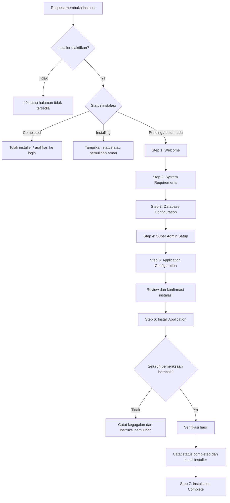
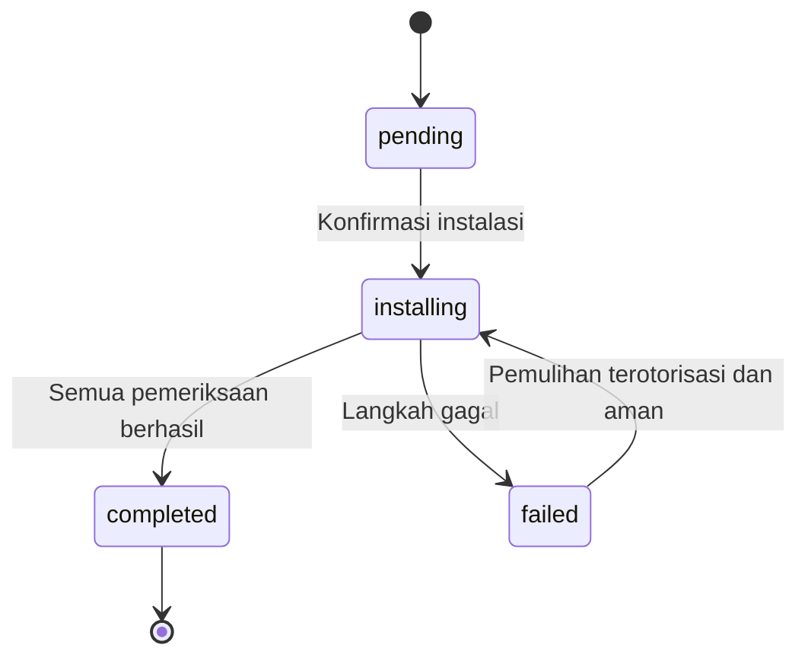

# Installation Wizard Specification

## Website Gereja Katolik Hati Santa Perawan Maria Tak Bernoda (HSPMTB) Putussibau

- **Dokumen:** Installation Wizard Specification
- **Status:** Draft untuk implementasi
- **Versi:** 1.0.0
- **Tanggal:** 28 Oktober 2026
- **Aplikasi:** Website Paroki HSPMTB Putussibau
- **Stack utama:** Laravel 13, Inertia.js, React 19, TypeScript, Vite 8, Tailwind CSS v4
- **Bahasa antarmuka:** Bahasa Indonesia
- **Zona waktu default:** `Asia/Pontianak`

---

## Daftar Isi

1. [Ringkasan](#1-ringkasan)
2. [Tujuan dan Prinsip Desain](#2-tujuan-dan-prinsip-desain)
3. [Ruang Lingkup](#3-ruang-lingkup)
4. [Aktor dan Hak Akses](#4-aktor-dan-hak-akses)
5. [Alur Instalasi](#5-alur-instalasi)
6. [Spesifikasi Setiap Step](#6-spesifikasi-setiap-step)
7. [Kebijakan Seeder](#7-kebijakan-seeder)
8. [Arsitektur Teknis](#8-arsitektur-teknis)
9. [Status dan Persistensi Instalasi](#9-status-dan-persistensi-instalasi)
10. [Kontrak Endpoint](#10-kontrak-endpoint)
11. [Validasi](#11-validasi)
12. [Keamanan](#12-keamanan)
13. [Penanganan Kegagalan dan Pemulihan](#13-penanganan-kegagalan-dan-pemulihan)
14. [Spesifikasi UI/UX dan Responsivitas](#14-spesifikasi-uiux-dan-responsivitas)
15. [Logging dan Audit](#15-logging-dan-audit)
16. [Pengujian](#16-pengujian)
17. [Kriteria Penerimaan](#17-kriteria-penerimaan)
18. [Rencana Implementasi](#18-rencana-implementasi)
19. [Keputusan dan Catatan Implementasi](#19-keputusan-dan-catatan-implementasi)

---

## 1. Ringkasan

Installation Wizard adalah alur onboarding satu kali untuk membantu administrator menyiapkan instalasi baru website Paroki HSPMTB. Wizard memeriksa persyaratan server, menguji koneksi database, mengumpulkan kredensial Super Admin, mengumpulkan konfigurasi awal aplikasi, menjalankan proses instalasi, kemudian memverifikasi dan mengunci installer.

Wizard dibangun di dalam aplikasi Laravel dengan UI React melalui Inertia.js. Wizard **bukan** fitur pengaturan ulang website yang sudah berjalan dan tidak boleh digunakan untuk menginstal ulang atau menghapus database produksi yang berisi data.

### 1.1 Keputusan utama

1. Wizard memiliki tujuh step.
2. Tidak ada migrasi atau seeder yang dijalankan sebelum pengguna menekan konfirmasi instalasi pada Step 6.
3. Akun Super Admin dibuat dari input Step 4; `SuperAdminSeeder` tidak dipanggil.
4. Identitas situs disimpan dari input Step 5 melalui `SiteSettingsService`; `SiteSettingsSeeder` tidak dipanggil.
5. Seeder produksi dipanggil secara eksplisit. `DatabaseSeeder` tidak dipanggil dari wizard.
6. Seeder demo dan konten pelayanan contoh tidak dijalankan otomatis.
7. Instalasi hanya boleh berjalan pada database yang telah lolos pemeriksaan sebagai instalasi baru.
8. Installer harus dikunci setelah instalasi sukses dan tidak boleh dapat dijalankan kembali melalui request HTTP biasa.
9. Jangan pernah menggunakan `migrate:fresh`, `db:wipe`, atau tindakan otomatis yang menghapus tabel/data.
10. Kegagalan tidak boleh menyebabkan sistem menganggap database yang sudah berubah sebagai database kosong.

### 1.2 Sasaran pengguna

- Administrator teknis yang memasang aplikasi pada server baru.
- Pengelola deployment yang menyiapkan environment baru untuk paroki.

Wizard bukan antarmuka untuk pengunjung umum dan bukan pengganti panel administrasi.

---

## 2. Tujuan dan Prinsip Desain

### 2.1 Tujuan

- Membuat instalasi baru lebih mudah dan konsisten.
- Menemukan masalah persyaratan server sebelum proses instalasi dimulai.
- Memastikan database dapat dijangkau dan aman digunakan untuk instalasi baru.
- Membuat akun Super Admin awal dengan role dan permission yang benar.
- Menyimpan identitas awal paroki tanpa mengisi data fiktif.
- Menghindari pemasukan konten demo ke website produksi.
- Menyediakan verifikasi dan status penyelesaian instalasi yang dapat dipercaya.

### 2.2 Prinsip

- **Backend sebagai sumber kebenaran:** status installer tidak boleh hanya bergantung pada state React, session, atau local storage.
- **Fail closed:** jika status instalasi tidak dapat dipastikan, jangan mengizinkan proses instalasi yang berisiko.
- **No destructive install:** tidak ada penghapusan tabel atau data otomatis.
- **Explicit seeding:** hanya seeder yang disetujui untuk produksi yang dipanggil.
- **Idempotency:** operasi yang bisa dicoba ulang harus aman terhadap eksekusi berulang.
- **Minimum data:** hanya data penting yang dikumpulkan dalam wizard.
- **No fabricated content:** data kontak, jadwal Misa, berita, pastor, komunitas, dan konten lainnya tidak boleh dibuat berdasarkan asumsi.
- **Secure secret handling:** password database dan Super Admin tidak boleh ditulis ke log atau disimpan sebagai teks biasa dalam tabel status.
- **Responsive and accessible:** seluruh step harus dapat digunakan pada desktop, tablet, dan ponsel.

---

## 3. Ruang Lingkup

### 3.1 Termasuk

- Pemeriksaan status instalasi.
- Welcome screen.
- Pemeriksaan versi PHP, ekstensi, folder, dan kebutuhan server.
- Pengujian koneksi database.
- Pemeriksaan apakah database layak untuk instalasi baru.
- Pengumpulan input Super Admin.
- Pengumpulan konfigurasi aplikasi dan identitas paroki.
- Proses migrasi dan seeder produksi terpilih.
- Pembuatan Super Admin.
- Penyimpanan pengaturan identitas situs.
- Verifikasi akhir.
- Pencatatan status instalasi.
- Penguncian endpoint installer setelah selesai.
- Penanganan kegagalan yang aman dan instruksi pemulihan.

### 3.2 Tidak termasuk

- Mengimpor konten lengkap dari website lama.
- Membuat jadwal Misa atau agenda fiktif.
- Mengisi berita, artikel, pastor, pengurus, komunitas, galeri, atau dokumen dengan data contoh.
- Mengelola konfigurasi seluruh server hosting.
- Mengubah kredensial database di server tanpa mekanisme deployment yang disetujui.
- Menghapus database untuk mengulang instalasi.
- Menyediakan fungsi reinstall pada website yang sudah aktif.
- Mengganti panel Pengaturan Situs yang sudah ada.

### 3.3 Prasyarat deployment

Sebelum installer dapat digunakan, deployment harus memastikan:

- Source code telah ditempatkan di server.
- Dependensi PHP dan frontend telah terpasang sesuai proses deployment.
- File konfigurasi dasar tersedia atau mekanisme konfigurasi environment dapat digunakan.
- Server dapat mengakses direktori yang diperlukan.
- Installer diaktifkan secara eksplisit untuk instalasi baru.
- Database target telah dibuat dan kredensialnya tersedia.
- Backup tersedia jika environment bukan database baru.

> Catatan: cara menulis konfigurasi `.env` bergantung pada hosting dan permission file. Wizard tidak boleh mengklaim telah menyimpan konfigurasi environment jika mekanisme itu belum benar-benar diimplementasikan dan diverifikasi.

---

## 4. Aktor dan Hak Akses

### 4.1 Pengguna installer

Sebelum instalasi selesai, belum ada sesi Super Admin yang dapat digunakan. Karena itu, installer menggunakan akses terbatas yang hanya tersedia saat instalasi baru diaktifkan.

Akses installer tidak boleh memberikan akses ke modul administrasi umum atau endpoint sensitif lain.

### 4.2 Super Admin

Super Admin dibuat pada Step 6 berdasarkan input Step 4. Role harus diambil dari konstanta atau definisi role yang sudah digunakan codebase, bukan string yang tersebar tanpa sumber kebenaran tunggal.

Setelah instalasi selesai, pengguna masuk melalui halaman login admin normal.

### 4.3 Pengunjung

Pengunjung tidak boleh dapat mengakses endpoint yang memeriksa kredensial database, membuat akun, menjalankan migrasi, atau memanggil seeder.

### 4.4 Kebijakan akses

- Semua endpoint installer memeriksa status instalasi di backend.
- Endpoint pengujian database diberi rate limit.
- Endpoint eksekusi instalasi hanya dapat dipanggil pada state yang valid.
- Jika aplikasi sudah terinstal, seluruh endpoint mutasi installer ditolak.
- UI yang tersembunyi bukan mekanisme keamanan; pemeriksaan server tetap wajib.

---

## 5. Alur Instalasi



### 5.1 Navigasi

- Tombol **Lanjutkan** berpindah ke step berikutnya setelah validasi step saat ini berhasil.
- Tombol **Kembali** kembali ke step sebelumnya tanpa menghapus input yang masih valid.
- Step 6 tidak boleh dijalankan hanya karena pengguna mengakses URL step secara langsung.
- Step 6 membutuhkan konfirmasi eksplisit sebelum perubahan database dilakukan.
- Step 7 hanya boleh ditampilkan sebagai status sukses setelah verifikasi backend berhasil.
- Jika browser refresh pada Step 6, backend harus menentukan status aktual; frontend tidak boleh memulai instalasi kedua secara otomatis.

### 5.2 Penyimpanan data wizard sebelum instalasi

Input yang dikumpulkan sebelum Step 6 dapat disimpan sementara pada session server yang terlindungi, atau mekanisme sementara terenkripsi dengan masa berlaku pendek. Jangan menyimpan password dalam local storage, query string, URL, atau log.

Jika session habis, minta pengguna mengisi kembali input sensitif. Tidak perlu menyimpan password Super Admin secara permanen sebelum eksekusi.

---

## 6. Spesifikasi Setiap Step

## 6.1 Step 1 — Welcome

### Tujuan

Memberi konteks tentang installer, langkah yang akan dilakukan, dan batasan penggunaan.

### Konten UI

- Logo Paroki HSPMTB.
- Judul: **Selamat datang di Website Paroki HSPMTB Putussibau**.
- Deskripsi singkat bahwa wizard akan menyiapkan instalasi baru.
- Ringkasan proses:
  - Memeriksa persyaratan sistem.
  - Mengonfigurasi dan menguji database.
  - Membuat akun Super Admin.
  - Mengatur identitas website.
  - Menjalankan dan memverifikasi instalasi.
- Peringatan bahwa wizard hanya untuk instalasi baru.
- Tombol **Mulai Instalasi**.

### Perilaku

- Tidak menjalankan migrasi.
- Tidak menjalankan seeder.
- Tidak membuat user.
- Tidak menulis pengaturan situs.
- Backend memeriksa apakah installer diaktifkan dan status instalasi mengizinkan proses baru.

### Kriteria selesai

Pengguna dapat melanjutkan jika installer aktif dan backend belum menyatakan instalasi selesai.

---

## 6.2 Step 2 — System Requirements

### Tujuan

Memastikan server memiliki kemampuan minimum untuk menjalankan aplikasi sebelum konfigurasi database dilakukan.

### Pemeriksaan

Daftar pemeriksaan harus disesuaikan dengan `composer.json`, konfigurasi aplikasi, dependensi yang digunakan, dan kebutuhan deployment aktual.

Pemeriksaan yang direncanakan:

| Pemeriksaan                 | Hasil yang ditampilkan                                     |
| --------------------------- | ---------------------------------------------------------- |
| Versi PHP                   | Versi terdeteksi dan status memenuhi/tidak                 |
| Ekstensi PHP wajib          | Daftar ekstensi yang tersedia dan hilang                   |
| Direktori `storage`         | Dapat ditulis atau tidak                                   |
| Direktori `bootstrap/cache` | Dapat ditulis atau tidak                                   |
| File konfigurasi dasar      | Tersedia dan dapat dibaca atau tidak                       |
| Dependensi aplikasi         | Status dependensi yang diperlukan                          |
| Koneksi aplikasi dasar      | Informasi yang aman untuk membantu diagnosis, bila relevan |

Jangan mengarang daftar ekstensi final. Daftar wajib harus diverifikasi terhadap dependensi Laravel dan package yang benar-benar digunakan oleh repository.

### Status pemeriksaan

- **Lulus:** persyaratan terpenuhi.
- **Peringatan:** tidak ideal tetapi tidak memblokir instalasi.
- **Gagal:** kondisi wajib tidak terpenuhi; pengguna tidak dapat melanjutkan.

### Perilaku

- Pemeriksaan bersifat read-only.
- Tidak membuat atau mengubah tabel database.
- Tidak menampilkan path sensitif yang tidak diperlukan.
- Tidak menampilkan environment variable atau secret.

### UI

- Setiap pemeriksaan ditampilkan sebagai baris dengan nama, keterangan, dan badge status.
- Sediakan tombol **Periksa Ulang**.
- Tombol **Lanjutkan** aktif hanya jika seluruh pemeriksaan wajib lulus.
- Tampilkan petunjuk tindakan untuk setiap pemeriksaan yang gagal.

---

## 6.3 Step 3 — Database Configuration

### Tujuan

Mengumpulkan konfigurasi koneksi database, menguji koneksi, dan memastikan database target layak digunakan untuk instalasi baru.

### Input

| Field             |                  Wajib | Keterangan                                        |
| ----------------- | ---------------------: | ------------------------------------------------- |
| Database driver   |                     Ya | Hanya driver yang benar-benar didukung aplikasi   |
| Database host     |                     Ya | Host database                                     |
| Database port     |                     Ya | Default mengikuti driver yang dipilih             |
| Database name     |                     Ya | Nama database target                              |
| Database username |                     Ya | Pengguna database                                 |
| Database password | Bergantung konfigurasi | Password koneksi; selalu ditangani sebagai secret |

Jangan mengasumsikan semua driver didukung. Daftar driver harus mengikuti driver Laravel dan konfigurasi yang telah diuji untuk aplikasi.

### Aksi

- **Uji Koneksi:** mencoba koneksi dengan input saat ini tanpa menjalankan migrasi.
- **Lanjutkan:** hanya aktif setelah koneksi berhasil dan pemeriksaan kelayakan database lulus.

### Pemeriksaan keamanan dan kelayakan database

Installer harus memastikan database target tidak berisi data aplikasi yang perlu dipertahankan. Minimal:

- Periksa apakah database dapat dijangkau.
- Periksa apakah database memiliki tabel aplikasi yang menunjukkan instalasi atau data yang sudah ada.
- Periksa status installer jika tabel status telah tersedia.
- Jika database berisi tabel atau data yang tidak dapat diklasifikasikan dengan aman, hentikan proses dan minta pemeriksaan manual.
- Jangan menganggap database kosong hanya karena tabel `installation_status` belum ada.
- Jangan menjalankan `migrate:fresh`, `db:wipe`, `DROP TABLE`, atau perintah penghapusan otomatis.

Pemeriksaan database harus dirancang berdasarkan skema dan migrasi aktual. Jangan memakai satu indikator saja untuk memutuskan bahwa database aman.

### Feedback UI

- Berhasil: tampilkan status koneksi berhasil.
- Gagal: tampilkan pesan aman dan ringkas, misalnya host tidak dapat dijangkau atau autentikasi ditolak.
- Jangan tampilkan password atau connection string lengkap.
- Sediakan tombol **Uji Koneksi** dan **Kembali**.

### Persistensi

Kredensial hanya disimpan selama diperlukan. Jika installer harus menulis konfigurasi koneksi ke environment, proses tersebut harus eksplisit, aman, dan memiliki verifikasi hasil. Jika deployment menggunakan environment yang dikelola di luar aplikasi, tampilkan instruksi manual alih-alih berpura-pura mengubahnya.

---

## 6.4 Step 4 — Super Admin Setup

### Tujuan

Mengumpulkan identitas akun administrator pertama. Akun belum dibuat sampai Step 6.

### Input

| Field               | Wajib | Aturan                                           |
| ------------------- | ----: | ------------------------------------------------ |
| Nama lengkap        |    Ya | String nonkosong dengan batas panjang yang wajar |
| Email               |    Ya | Format email valid dan dinormalisasi             |
| Password            |    Ya | Memenuhi kebijakan password aplikasi             |
| Konfirmasi password |    Ya | Harus sama dengan password                       |

### Perilaku

- Validasi input di backend.
- Jangan membuat user saat step dibuka atau saat tombol Lanjutkan ditekan.
- Jangan menaruh password dalam local storage atau URL.
- Jangan mencatat password ke log.
- Jangan mengizinkan pengguna memilih role. Role akun awal ditetapkan oleh installer sebagai Super Admin.
- Pada eksekusi final, pastikan role dan permission sudah tersedia sebelum menetapkan role kepada user.

### Konflik email

Jika database bukan database baru atau email telah terpakai, installer tidak boleh mengubah password akun yang sudah ada. Database harus dinyatakan tidak layak untuk instalasi baru atau memerlukan tindakan operator yang terotorisasi.

### Feedback UI

- Indikator kekuatan password boleh digunakan, tetapi validasi server tetap menjadi sumber kebenaran.
- Pesan validasi harus spesifik tanpa membocorkan data akun lain.
- Password dapat ditampilkan/disembunyikan melalui kontrol yang dapat diakses keyboard.

---

## 6.5 Step 5 — Application Configuration

### Tujuan

Mengumpulkan konfigurasi dasar aplikasi dan identitas awal paroki sebelum proses instalasi final.

### 6.5.1 Identitas paroki

Sesuai keputusan produk, wizard mengumpulkan lima field berikut:

| Label             | Key pengaturan      | Wajib | Catatan                       |
| ----------------- | ------------------- | ----: | ----------------------------- |
| Nama Paroki       | `parish_name`       |    Ya | Nama resmi paroki             |
| Nama Singkat      | `parish_short_name` |    Ya | Nama pendek yang digunakan UI |
| Tagline           | `tagline`           | Tidak | Boleh kosong                  |
| Deskripsi Singkat | `short_description` | Tidak | Boleh kosong                  |
| Patron Santo      | `patron_saint`      | Tidak | Boleh kosong                  |

Nilai disimpan menggunakan `SiteSettingsService` dan definisi key yang sudah ada di `config/site-settings.php`. Jangan membuat tabel atau sistem pengaturan paralel.

### 6.5.2 Konfigurasi aplikasi

Field teknis yang direncanakan:

| Field               | Kebijakan                                                                                                |
| ------------------- | -------------------------------------------------------------------------------------------------------- |
| Nama aplikasi       | Default dapat menggunakan nama singkat website; konfirmasi perilakunya dengan konfigurasi Laravel aktual |
| URL aplikasi        | Harus berupa URL absolut yang valid; gunakan URL deployment sebenarnya                                   |
| Zona waktu tampilan | Default `Asia/Pontianak`                                                                                 |
| Bahasa              | Default `id` jika aplikasi mendukung konfigurasi locale ini                                              |
| Environment         | Tidak boleh diubah menjadi production tanpa memahami proses deployment dan cache konfigurasi             |

Jangan menganggap semua nilai di atas otomatis dapat diubah dari browser. Sebagian konfigurasi Laravel dibaca dari environment dan mungkin memerlukan perubahan konfigurasi deployment serta cache. Implementasi harus membedakan pengaturan database dari konfigurasi runtime.

### 6.5.3 Input opsional

- Field opsional boleh kosong.
- Jangan memasukkan data rekaan sebagai pengganti nilai kosong.
- Validasi panjang input dan normalisasi string.
- Untuk URL, lakukan validasi URL.
- Jangan mengizinkan input identitas mengubah key pengaturan di luar daftar yang diizinkan.

### Perilaku

- Tidak menjalankan seeder.
- Tidak menyimpan identitas ke database sebelum pengguna mengonfirmasi instalasi.
- Menampilkan ringkasan konfigurasi pada review sebelum Step 6.
- Jangan meminta alamat, nomor telepon, atau email paroki jika tidak menjadi kebutuhan yang disepakati untuk wizard ini.

---

## 6.6 Step 6 — Install Application

### Tujuan

Menjalankan seluruh perubahan instalasi setelah pengguna mengonfirmasi bahwa konfigurasi sudah benar.

### Konfirmasi sebelum mulai

Sebelum memulai, tampilkan ringkasan:

- Database target (jangan menampilkan password).
- Email Super Admin.
- Nama paroki dan nama singkat.
- Zona waktu dan URL aplikasi.
- Pernyataan bahwa proses akan membuat tabel, role, kategori awal, akun Super Admin, dan pengaturan awal.
- Peringatan untuk memastikan database memang baru dan tidak berisi data yang perlu dipertahankan.
- Tombol final **Install Now**.

Setelah pengguna menekan tombol final, cegah pengiriman ganda di frontend dan backend.

### Urutan proses

1. Validasi ulang state installer dan konfigurasi yang tersimpan.
2. Ambil lock instalasi agar hanya satu proses yang dapat berjalan.
3. Verifikasi kembali kelayakan database.
4. Terapkan konfigurasi koneksi yang telah disetujui sesuai mekanisme deployment.
5. Jalankan migrasi normal yang belum diterapkan; jangan menghapus tabel.
6. Jalankan seeder produksi yang disetujui.
7. Buat akun Super Admin dari input Step 4.
8. Tetapkan role Super Admin menggunakan role yang dibuat oleh `PermissionSeeder`.
9. Simpan lima identitas paroki melalui `SiteSettingsService`.
10. Terapkan konfigurasi runtime yang memang menjadi tanggung jawab installer.
11. Jalankan pemeriksaan integritas.
12. Simpan status `completed` hanya jika semua pemeriksaan wajib berhasil.
13. Kunci installer.
14. Arahkan UI ke Step 7.

### Seeder produksi

Seeder yang dipanggil secara eksplisit:

1. `PermissionSeeder`
2. `PostCategorySeeder`
3. `EventCategorySeeder`
4. `ServiceCategorySeeder`
5. `DocumentCategorySeeder`
6. `CommunityCategorySeeder`

**Tidak dipanggil oleh wizard:**

- `SuperAdminSeeder` — akun dibuat dari input Step 4.
- `SiteSettingsSeeder` — identitas disimpan dari input Step 5.
- `ServiceSeeder` — konten pelayanan perlu diverifikasi sebelum digunakan.
- `DemoContentSeeder` dan seeder demo turunannya — tidak boleh dijalankan untuk instalasi produksi.
- `DatabaseSeeder` — tidak dipanggil karena menjalankan kumpulan seeder yang terlalu luas untuk kebutuhan installer.

Sebelum implementasi, verifikasi nama class, namespace, dependensi, dan perilaku idempotensi setiap seeder terhadap repository terkini. Daftar ini adalah kebijakan eksekusi yang disepakati, bukan jaminan bahwa semua class sudah memiliki karakteristik idempoten.

### Progress UI

Tampilkan tahap proses secara bertahap, misalnya:

- Memvalidasi konfigurasi.
- Menyiapkan database.
- Menjalankan migrasi.
- Menyiapkan role dan permission.
- Menyiapkan kategori awal.
- Membuat akun Super Admin.
- Menyimpan identitas paroki.
- Memverifikasi instalasi.
- Mengunci installer.

Progress harus berasal dari status backend. Jangan menampilkan persentase yang mengklaim pekerjaan selesai jika backend belum mengonfirmasinya.

### Pembatasan request

- Hanya satu proses instalasi aktif.
- Request ganda harus ditolak atau mengembalikan status proses yang sama.
- Jangan menjalankan migrasi/seeder dari request paralel.
- Gunakan timeout dan batas resource yang realistis untuk lingkungan hosting.
- Jika proses terlalu lama untuk satu request HTTP, evaluasi mekanisme job/background yang kompatibel dengan hosting. Jangan membuat UI menganggap proses berhasil hanya karena request telah dikirim.

---

## 6.7 Step 7 — Installation Complete

### Tujuan

Menampilkan hasil akhir setelah backend memverifikasi instalasi berhasil.

### Pemeriksaan wajib sebelum sukses

- Migrasi inti tercatat telah diterapkan.
- Role Super Admin tersedia.
- Akun Super Admin berhasil dibuat dan mempunyai role yang tepat.
- Pengaturan `parish_name` dan `parish_short_name` berhasil disimpan.
- Instalasi tercatat `completed`.
- Endpoint installer tidak lagi mengizinkan operasi mutasi.
- Route login admin dapat diakses.

### Konten UI

- Ikon sukses.
- Judul: **Instalasi Berhasil**.
- Nama website/paroki.
- Ringkasan akun Super Admin berupa nama dan email, bukan password.
- Tombol **Buka Website**.
- Tombol **Ke Halaman Login Admin**.
- Daftar tindakan selanjutnya:
  - Login ke panel administrasi.
  - Periksa pengaturan identitas paroki.
  - Tambahkan data resmi jadwal Misa, berita, agenda, pelayanan, komunitas, galeri, dan dokumen.
  - Periksa konfigurasi backup dan keamanan deployment.

### Perilaku

- Tidak ada password yang ditampilkan kembali.
- Step 7 tidak dapat dicapai hanya dengan mengganti parameter URL.
- Jika status backend bukan `completed`, tampilkan status aktual dan instruksi aman, bukan halaman sukses.
- Endpoint installer yang mengubah data harus sudah terkunci.

---

## 7. Kebijakan Seeder

### 7.1 Matriks keputusan

| Seeder                    | Keputusan                     | Alasan                                                                            |
| ------------------------- | ----------------------------- | --------------------------------------------------------------------------------- |
| `PermissionSeeder`        | Jalankan                      | Menyiapkan role dan permission aplikasi                                           |
| `PostCategorySeeder`      | Jalankan                      | Kategori referensi berita                                                         |
| `EventCategorySeeder`     | Jalankan                      | Kategori referensi agenda                                                         |
| `ServiceCategorySeeder`   | Jalankan                      | Kategori referensi pelayanan                                                      |
| `DocumentCategorySeeder`  | Jalankan                      | Kategori referensi dokumen                                                        |
| `CommunityCategorySeeder` | Jalankan                      | Kategori referensi komunitas                                                      |
| `SuperAdminSeeder`        | Jangan jalankan               | Akun dibuat dari input wizard                                                     |
| `SiteSettingsSeeder`      | Jangan jalankan               | Identitas awal disimpan dari input wizard                                         |
| `ServiceSeeder`           | Jangan otomatis               | Konten harus diaudit dan dikonfirmasi                                             |
| `DemoContentSeeder`       | Jangan jalankan               | Memasukkan konten demonstrasi                                                     |
| Seeder turunan demo       | Jangan jalankan               | Termasuk jadwal Misa, berita, agenda, identitas paroki, komunitas, dan media demo |
| `DatabaseSeeder`          | Jangan panggil dari installer | Memanggil beberapa seeder yang tidak cocok untuk instalasi produksi               |

### 7.2 Persyaratan seeder

- Seeder kategori sebaiknya idempoten.
- Gunakan key stabil seperti slug untuk menghindari duplikasi.
- Seeder tidak boleh menimpa konten yang telah diubah pengguna tanpa alasan yang jelas.
- Jika seeder perlu dijalankan ulang setelah kegagalan, pastikan perilakunya aman.
- Permission cache Spatie harus dibersihkan sesuai cara yang direkomendasikan package/codebase setelah perubahan role atau permission.
- Kegagalan salah satu seeder harus menghentikan proses finalisasi.
- Jangan menjalankan seeder demo berdasarkan konfigurasi default yang tidak aman untuk produksi.

### 7.3 Site settings

Wizard tidak memanggil `SiteSettingsSeeder`. Setelah migrasi, simpan lima field identitas melalui `SiteSettingsService`:

- `parish_name`
- `parish_short_name`
- `tagline`
- `short_description`
- `patron_saint`

Periksa implementasi `SiteSettingsService` untuk memastikan perilaku nilai kosong, validasi key, cache invalidation, dan tipe nilai. Jangan membuat mekanisme pengaturan baru.

---

## 8. Arsitektur Teknis

### 8.1 Komponen backend yang disarankan

Nama berikut adalah usulan struktur implementasi; sesuaikan dengan konvensi aktual codebase.

```text
app/
├── Http/
│   ├── Controllers/
│   │   └── Installation/
│   │       └── InstallationWizardController.php
│   ├── Requests/
│   │   └── Installation/
│   │       ├── TestDatabaseConnectionRequest.php
│   │       ├── StoreSuperAdminSetupRequest.php
│   │       ├── StoreApplicationConfigurationRequest.php
│   │       └── RunInstallationRequest.php
│   └── Middleware/
│       └── EnsureInstallerAvailable.php
├── Services/
│   └── Installation/
│       ├── InstallationStatusService.php
│       ├── SystemRequirementsChecker.php
│       ├── DatabaseConnectionTester.php
│       ├── DatabaseReadinessChecker.php
│       ├── InstallationService.php
│       ├── ProductionSeederRunner.php
│       └── InstallationVerifier.php
└── Models/
    └── InstallationStatus.php
```

Struktur ini bersifat rekomendasi. Jangan membuat class duplikat jika codebase sudah memiliki komponen dengan tanggung jawab yang sama.

### 8.2 Frontend yang disarankan

```text
resources/js/
└── pages/
    └── installation/
        ├── Welcome.tsx
        ├── SystemRequirements.tsx
        ├── DatabaseConfiguration.tsx
        ├── SuperAdminSetup.tsx
        ├── ApplicationConfiguration.tsx
        ├── InstallApplication.tsx
        └── InstallationComplete.tsx
```

Komponen bersama yang dapat dipertimbangkan:

- `InstallationLayout`
- `InstallationSidebar` atau `InstallationProgress`
- `StepHeader`
- `RequirementStatusRow`
- `PasswordField`
- `ConnectionStatus`
- `InstallationProgressList`
- `InstallationErrorPanel`
- `ReviewSummary`

Gunakan komponen UI dan pola form yang sudah digunakan proyek. Hindari membuat sistem desain paralel.

### 8.3 Tanggung jawab

| Komponen                    | Tanggung jawab                                                              |
| --------------------------- | --------------------------------------------------------------------------- |
| Controller                  | Menerima request, memanggil service, mengembalikan response/Inertia props   |
| Form Request                | Validasi input dan normalisasi yang relevan                                 |
| `SystemRequirementsChecker` | Pemeriksaan persyaratan server                                              |
| `DatabaseConnectionTester`  | Menguji koneksi tanpa migrasi                                               |
| `DatabaseReadinessChecker`  | Memutuskan apakah database layak untuk instalasi baru                       |
| `ProductionSeederRunner`    | Menjalankan hanya seeder yang disetujui                                     |
| `InstallationService`       | Mengorkestrasi urutan instalasi dan locking                                 |
| `InstallationStatusService` | Membaca dan memperbarui status instalasi                                    |
| `InstallationVerifier`      | Memastikan hasil akhir benar                                                |
| React pages                 | Menampilkan UI dan mengirim input ke backend; bukan sumber kebenaran status |

---

## 9. Status dan Persistensi Instalasi

### 9.1 Rekomendasi penyimpanan

Gunakan status instalasi yang persisten di backend. Pilihan implementasi yang disarankan adalah tabel khusus, misalnya `installation_status`, dengan satu record untuk instalasi aplikasi ini.

Skema konseptual:

| Kolom             | Tujuan                                                        |
| ----------------- | ------------------------------------------------------------- |
| `id`              | Primary key                                                   |
| `status`          | `pending`, `installing`, `failed`, atau `completed`           |
| `current_step`    | Tahap proses terakhir                                         |
| `started_at`      | Waktu mulai proses                                            |
| `completed_at`    | Waktu selesai jika berhasil                                   |
| `failed_at`       | Waktu kegagalan jika ada                                      |
| `last_error_code` | Kode error yang aman, bukan secret atau stack trace mentah    |
| `metadata`        | Metadata terbatas yang tidak sensitif, jika memang dibutuhkan |
| `created_at`      | Waktu pembuatan record                                        |
| `updated_at`      | Waktu pembaruan                                               |

Jangan menyimpan password database, password Super Admin, session secret, atau connection string di tabel ini.

### 9.2 Masalah bootstrap tabel status

Tabel status belum ada sebelum migrasi pertama. Karena itu, keberadaan tabel tersebut saja tidak cukup untuk memutuskan apakah database baru atau aman diinstal.

Sebelum migrasi, installer harus menggunakan mekanisme bootstrap yang tidak merusak data dan melakukan pemeriksaan database. Setelah migrasi membuat tabel status, status dapat dicatat secara persisten.

Jangan menafsirkan “tabel status belum ada” sebagai “database pasti kosong”.

### 9.3 State machine



### 9.4 Aturan transisi

- `pending` dapat mulai ke `installing` jika seluruh prasyarat lulus.
- `installing` tidak boleh dimulai ulang oleh request paralel.
- `failed` tidak otomatis berarti database aman untuk dicoba ulang.
- `failed` hanya dapat dilanjutkan setelah pemeriksaan integritas menentukan langkah yang aman.
- `completed` bersifat terminal untuk installer publik.
- Reset status tidak boleh menjadi fitur HTTP publik.
- Perubahan status harus dilakukan oleh backend, bukan dikirim bebas dari browser.

### 9.5 Alternatif file marker

File marker dapat menjadi lapisan tambahan, tetapi tidak disarankan sebagai satu-satunya sumber kebenaran jika status proses dan pemulihan perlu dilacak. Jika dipakai, file harus berada di lokasi yang tidak dapat diakses langsung dari web dan permission-nya dibatasi.

---

## 10. Kontrak Endpoint

Rute berikut adalah kontrak konseptual. Nama dan metode HTTP final harus mengikuti konvensi route Laravel yang ada.

| Method | Endpoint contoh                 | Tujuan                                        | Mengubah database aplikasi? |
| ------ | ------------------------------- | --------------------------------------------- | --------------------------: |
| `GET`  | `/install`                      | Menampilkan Step 1 jika installer tersedia    |                       Tidak |
| `GET`  | `/install/requirements`         | Mengambil hasil pemeriksaan sistem            |                       Tidak |
| `POST` | `/install/requirements/check`   | Menjalankan ulang pemeriksaan sistem          |                       Tidak |
| `POST` | `/install/database/test`        | Menguji koneksi database                      |                       Tidak |
| `POST` | `/install/super-admin/validate` | Memvalidasi input Super Admin                 |                       Tidak |
| `POST` | `/install/application/validate` | Memvalidasi konfigurasi aplikasi              |                       Tidak |
| `POST` | `/install/run`                  | Memulai instalasi setelah konfirmasi          |                          Ya |
| `GET`  | `/install/progress`             | Mengambil status proses instalasi             |                       Tidak |
| `GET`  | `/install/complete`             | Menampilkan sukses jika backend terverifikasi |                       Tidak |

### 10.1 Persyaratan endpoint

- Gunakan middleware untuk memeriksa installer aktif dan status instalasi.
- Gunakan CSRF protection untuk request mutasi berbasis session.
- Batasi percobaan endpoint pengujian database.
- Validasi seluruh input di server.
- Jangan mengembalikan stack trace, query SQL mentah, password, atau konfigurasi rahasia.
- Endpoint `/install/run` harus memiliki proteksi terhadap request ganda.
- Endpoint status hanya mengembalikan informasi yang diperlukan UI.
- Jika aplikasi telah selesai diinstal, endpoint mutasi installer ditolak dengan respons yang sesuai.

### 10.2 Status HTTP

Gunakan status HTTP yang konsisten:

- `200` untuk pemeriksaan atau status berhasil.
- `422` untuk input yang tidak valid.
- `409` untuk state instalasi yang konflik, misalnya proses sudah berjalan atau instalasi selesai.
- `429` untuk rate limit.
- `503` untuk kondisi sistem sementara tidak siap.
- Jangan mengungkap detail internal melalui pesan error.

---

## 11. Validasi

### 11.1 Database

- Driver harus termasuk daftar yang didukung.
- Host dan database wajib terisi.
- Port harus berupa angka dalam rentang valid.
- Username wajib sesuai kebijakan koneksi.
- Password tidak pernah dikembalikan ke frontend setelah dikirim.
- Uji koneksi harus menggunakan koneksi sementara yang tidak mengubah koneksi default secara permanen tanpa kontrol.
- Hindari SQL injection dengan menggunakan API konfigurasi/driver, bukan merangkai query dari input mentah.
- Validasi database readiness sebelum migrasi.

### 11.2 Super Admin

- Nama wajib.
- Email valid dan dinormalisasi.
- Password harus mengikuti kebijakan password aplikasi.
- Konfirmasi password harus sama.
- Akun tidak boleh menimpa user yang sudah ada.
- Role selalu ditetapkan backend.

### 11.3 Identitas paroki

- `parish_name`: wajib, string nonkosong, batas panjang wajar.
- `parish_short_name`: wajib, string nonkosong, batas panjang wajar.
- `tagline`: opsional.
- `short_description`: opsional.
- `patron_saint`: opsional.
- Tolak payload yang mencoba menulis key pengaturan lain.
- Lakukan trimming whitespace.
- Hindari menyimpan string `"null"` sebagai nilai kosong.
- Ikuti konvensi `SiteSettingsService` untuk nilai kosong dan cache.

### 11.4 URL dan timezone

- URL aplikasi harus valid dan absolut jika diminta.
- Zona waktu harus dipilih dari daftar timezone yang valid.
- Default zona waktu: `Asia/Pontianak`.
- Jangan memperbarui konfigurasi runtime yang telah dicache tanpa mekanisme yang tepat.

---

## 12. Keamanan

### 12.1 Prinsip keamanan wajib

1. Installer nonaktif secara default atau membutuhkan flag aktivasi yang eksplisit.
2. Installer hanya boleh digunakan untuk instalasi baru.
3. Seluruh pemeriksaan status dilakukan di backend.
4. Tidak ada operasi destructive untuk mengulang instalasi.
5. Tidak ada password di log, URL, analytics, exception context, atau tabel status.
6. Endpoint mutasi dilindungi CSRF, validasi, rate limit, dan state check.
7. Hanya satu proses instalasi dapat berjalan pada satu waktu.
8. Instalasi yang sudah selesai tidak dapat diulang melalui endpoint publik.
9. Jangan mengembalikan exception mentah kepada pengguna.
10. Data konfigurasi sementara dibatasi masa berlakunya dan dibersihkan setelah sukses/gagal sesuai kebijakan.
11. Kredensial database tidak boleh ditampilkan kembali setelah diuji.
12. Akun yang telah ada tidak boleh ditimpa oleh proses installer.

### 12.2 Installer lock

Kunci installer menggunakan lebih dari sekadar UI. Gunakan kombinasi:

- Status `completed` yang persisten.
- Middleware backend yang menolak request installer.
- Flag konfigurasi/aktivasi yang dikelola deployment.
- Pengujian bahwa endpoint tidak dapat memulai ulang proses.

### 12.3 Risiko konfigurasi `.env`

Penulisan `.env` dari aplikasi web memiliki risiko operasional dan keamanan. Sebelum fitur ini diimplementasikan, tentukan secara eksplisit apakah:

- Installer memang bertanggung jawab menulis `.env`, atau
- File environment dikelola melalui deployment/hosting dan wizard hanya menguji konfigurasi yang telah disiapkan.

Jika menulis `.env`, implementasi harus menangani permission, backup yang aman, atomic write, escaping nilai, validasi, dan kegagalan penulisan. Jangan membuat salinan `.env` berisi secret di lokasi publik atau log.

### 12.4 Database readiness bukan pengganti backup

Pemeriksaan tabel membantu menghindari salah target, tetapi tidak menjamin database tidak berisi data penting. Untuk database yang tidak jelas statusnya, hentikan instalasi dan minta pemeriksaan manual.

---

## 13. Penanganan Kegagalan dan Pemulihan

### 13.1 Prinsip

- Tidak menjanjikan rollback penuh jika migrasi dan operasi file tidak dapat dibatalkan secara atomik.
- Jangan menghapus data untuk kembali ke state awal.
- Catat langkah terakhir yang berhasil.
- Jangan mengulang semua langkah tanpa memeriksa kondisi database.
- Tampilkan pesan aman untuk pengguna dan simpan detail diagnostik yang dibatasi di log server.

### 13.2 Contoh kegagalan

| Kegagalan                           | Perilaku yang diharapkan                                                 |
| ----------------------------------- | ------------------------------------------------------------------------ |
| Persyaratan sistem gagal            | Blokir sebelum database                                                  |
| Koneksi database gagal              | Izinkan koreksi konfigurasi; tidak ada migrasi                           |
| Database tidak kosong/tidak jelas   | Hentikan instalasi dan minta database baru atau pemeriksaan manual       |
| Migrasi gagal                       | Tandai gagal, catat migrasi terakhir, jangan menjalankan `migrate:fresh` |
| Seeder gagal                        | Tandai gagal; periksa apakah aman dijalankan ulang                       |
| Pembuatan Super Admin gagal         | Jangan menandai selesai; periksa state sebelum pemulihan                 |
| Pengaturan identitas gagal          | Jangan menandai selesai; gunakan pemeriksaan dan pemulihan aman          |
| Verifikasi akhir gagal              | Jangan menampilkan sukses atau membuka installer sebagai selesai         |
| Request browser terputus            | Ambil status dari backend; jangan memulai proses kedua otomatis          |
| Installer dipanggil setelah selesai | Tolak request dan arahkan ke website/login                               |

### 13.3 Strategi pemulihan

Pemulihan harus menjadi prosedur terkontrol:

1. Baca status instalasi.
2. Baca log diagnostik yang tidak berisi secret.
3. Periksa migrasi yang sudah berjalan.
4. Periksa keberadaan role, user, kategori, dan pengaturan yang sudah dibuat.
5. Tentukan langkah yang aman untuk dilanjutkan.
6. Lanjutkan hanya dengan operasi yang idempoten atau setelah status diverifikasi.
7. Jika kondisi tidak dapat dipastikan, hentikan dan minta operator melakukan pemeriksaan/restore backup secara manual.

---

## 14. Spesifikasi UI/UX dan Responsivitas

### 14.1 Arah visual

Mengacu pada mockup yang disepakati:

- Tampilan bersih, modern, dan profesional.
- Latar belakang terang.
- Card putih dengan border halus dan shadow ringan.
- Aksen merah paroki untuk tombol utama dan step aktif.
- Teks utama berkontras tinggi; teks pendukung abu-abu.
- Status berhasil memakai hijau; peringatan memakai amber; kegagalan memakai merah.
- Logo HSPMTB digunakan secara konsisten.
- Foto gereja dapat digunakan sebagai elemen visual dekoratif pada desktop, tetapi tidak boleh mengganggu form atau aksesibilitas.
- Hindari dekorasi berat yang memperlambat instalasi.

### 14.2 Layout desktop

- Panel visual/branding di sisi kiri dapat menampilkan foto gereja.
- Navigasi tujuh step ditampilkan dengan status aktif, selesai, dan belum dikerjakan.
- Konten form berada di panel utama dengan lebar yang nyaman dibaca.
- Tombol navigasi konsisten di bagian bawah form.
- Step 6 menampilkan daftar tahapan dan status progres.

### 14.3 Layout tablet dan mobile

- Layout berubah menjadi satu kolom.
- Foto gereja diperkecil atau disembunyikan untuk memberi ruang pada form.
- Navigasi step menjadi progress bar atau daftar ringkas.
- Input dan tombol memenuhi lebar layar yang tersedia.
- Tidak ada horizontal overflow.
- Pesan error muncul dekat field terkait.
- Progress instalasi dapat dibaca oleh screen reader.

### 14.4 Interaksi dan aksesibilitas

- Semua input mempunyai label yang terlihat.
- Status tidak dibedakan hanya dengan warna.
- Tombol memiliki focus state.
- Form dapat digunakan dengan keyboard.
- Error dikaitkan dengan input terkait.
- Status proses diumumkan melalui live region yang sesuai.
- Tombol install dinonaktifkan selama request berjalan, tetapi backend tetap harus mencegah request ganda.
- Konfirmasi final menjelaskan dampak instalasi sebelum pengguna menyetujuinya.

### 14.5 State UI yang harus didukung

- Initial/loading.
- Valid.
- Validation error.
- Connection testing.
- Connection failed.
- Installation running.
- Installation failed.
- Recoverable failure.
- Completed.
- Installer locked.

---

## 15. Logging dan Audit

### 15.1 Yang boleh dicatat

- Waktu proses dimulai dan selesai.
- Step terakhir yang berhasil.
- Nama operasi, misalnya `migrate`, `seed_permissions`, atau `create_admin`.
- Kode error yang aman.
- Status akhir.
- Durasi langkah.
- ID korelasi proses jika tersedia.

### 15.2 Yang tidak boleh dicatat

- Password database.
- Password Super Admin.
- Session cookie/token.
- Connection string lengkap.
- Secret environment.
- Payload form sensitif.
- Stack trace mentah yang dikirim kepada browser.

### 15.3 Audit instalasi

Catatan instalasi harus cukup untuk membantu troubleshooting tanpa menyimpan secret. Setelah sukses, informasi audit dapat dipertahankan sesuai kebijakan retensi aplikasi.

---

## 16. Pengujian

### 16.1 Unit test

- `SystemRequirementsChecker` melaporkan persyaratan yang terpenuhi dan gagal.
- `DatabaseConnectionTester` mengembalikan hasil aman tanpa membocorkan kredensial.
- `InstallationStatusService` mengelola state dengan benar.
- `ProductionSeederRunner` hanya memanggil daftar seeder yang disetujui.
- `InstallationVerifier` menolak status sukses jika pemeriksaan wajib gagal.

### 16.2 Feature test

- Installer nonaktif tidak dapat diakses.
- Installer yang sudah selesai menolak request mutasi.
- Step requirements tidak mengubah database.
- Test koneksi tidak menjalankan migrasi.
- Database tidak layak menolak proses instalasi.
- Input Super Admin tidak membuat user sebelum Step 6.
- Email yang telah ada tidak ditimpa.
- Hanya lima setting identitas yang ditulis oleh wizard.
- Nilai opsional kosong ditangani sesuai konvensi service.
- Seeder demo tidak dipanggil.
- `DatabaseSeeder` tidak dipanggil oleh alur instalasi.
- Request instalasi ganda tidak menjalankan dua proses.
- Kegagalan seeder tidak menandai instalasi selesai.
- Verifikasi gagal mencegah Step 7 sukses.
- Setelah sukses, endpoint installer terkunci.

### 16.3 Integration test

- Migrasi dijalankan pada database test kosong.
- Permission dan role tersedia.
- Seeder kategori menghasilkan data yang diperlukan.
- Super Admin dibuat dengan role yang tepat.
- Pengaturan identitas dapat dibaca melalui `SiteSettingsService`.
- Cache pengaturan ter-invalidasi dengan benar.
- Login admin dapat diakses setelah instalasi.
- Instalasi tidak memasukkan akun atau konten demo.

### 16.4 E2E test

1. Membuka installer pada instalasi baru.
2. Menyelesaikan pemeriksaan persyaratan.
3. Memasukkan database yang valid.
4. Mengisi Super Admin.
5. Mengisi identitas paroki.
6. Mengonfirmasi instalasi.
7. Menunggu progress selesai.
8. Memastikan halaman sukses tampil.
9. Membuka website dan halaman login.
10. Memastikan installer tidak dapat dijalankan ulang.

Tambahkan skenario kegagalan koneksi, input tidak valid, database yang sudah berisi data, refresh saat instalasi berjalan, dan request ganda.

---

## 17. Kriteria Penerimaan

Fitur dinyatakan siap jika semua kriteria berikut terpenuhi.

### Fungsional

- [ ] Tujuh step tersedia sesuai urutan.
- [ ] Navigasi step bekerja dan input non-sensitif tetap tersedia saat kembali.
- [ ] Pemeriksaan persyaratan sistem berjalan tanpa mengubah database.
- [ ] Koneksi database dapat diuji sebelum migrasi.
- [ ] Database yang tidak jelas/berisi data ditolak secara aman.
- [ ] Akun Super Admin hanya dibuat pada proses final.
- [ ] Identitas paroki dikumpulkan pada Step 5.
- [ ] Pengaturan disimpan melalui `SiteSettingsService`.
- [ ] Seeder produksi yang disetujui dijalankan secara eksplisit.
- [ ] Seeder demo dan `DatabaseSeeder` tidak dipanggil.
- [ ] Status sukses hanya ditetapkan setelah verifikasi.

### Keamanan

- [ ] Installer nonaktif secara default atau membutuhkan aktivasi eksplisit.
- [ ] Tidak ada operasi destructive.
- [ ] Tidak ada secret di log atau response.
- [ ] Request ganda ditangani.
- [ ] Akun yang sudah ada tidak ditimpa.
- [ ] Installer terkunci setelah sukses.
- [ ] Status instalasi ditentukan backend.
- [ ] Kegagalan tidak membuka jalan untuk instalasi ulang tanpa pemeriksaan.

### UX

- [ ] Semua step responsif.
- [ ] Form mempunyai label dan validasi yang jelas.
- [ ] Status loading, gagal, dan sukses tersedia.
- [ ] Error memberikan instruksi yang dapat ditindaklanjuti.
- [ ] UI tidak menampilkan informasi sensitif.
- [ ] Navigasi dapat digunakan dengan keyboard.

### Operasional

- [ ] Log instalasi cukup untuk troubleshooting.
- [ ] Pemulihan kegagalan didokumentasikan.
- [ ] Instruksi deployment menjelaskan cara mengaktifkan dan menonaktifkan installer.
- [ ] Tes unit, feature, dan E2E penting lulus.

---

## 18. Rencana Implementasi

### Phase 1 — Audit dan persiapan

- Audit route, middleware, model, migrasi, permission, dan service pengaturan yang sudah ada.
- Konfirmasi daftar persyaratan server dari `composer.json` dan konfigurasi aktual.
- Audit semua seeder yang disetujui untuk idempotensi dan dependensi.
- Tentukan mekanisme aktivasi installer.
- Tentukan cara mengelola `.env` berdasarkan lingkungan hosting.
- Tentukan strategi bootstrap dan status instalasi.

**Definition of Done:** keputusan teknis dan risiko utama terdokumentasi sebelum perubahan database dilakukan.

### Phase 2 — Status dan guard installer

- Implementasikan status instalasi.
- Implementasikan guard/middleware installer.
- Tambahkan database readiness checker.
- Tambahkan lock agar instalasi tidak berjalan paralel.
- Tambahkan tes akses sebelum dan sesudah instalasi.

**Definition of Done:** installer tidak dapat dijalankan pada aplikasi yang sudah selesai diinstal.

### Phase 3 — UI Step 1–5

- Implementasikan layout dan navigasi step.
- Implementasikan requirements checker.
- Implementasikan database configuration dan test connection.
- Implementasikan Super Admin setup.
- Implementasikan application configuration.
- Implementasikan validasi backend dan UI.
- Pastikan secret tidak disimpan di browser.

**Definition of Done:** semua input tervalidasi dan belum ada perubahan final pada database sebelum konfirmasi.

### Phase 4 — Proses instalasi

- Implementasikan orkestrasi instalasi.
- Jalankan migrasi normal.
- Jalankan seeder yang disetujui.
- Buat Super Admin.
- Simpan identitas paroki.
- Catat progres dan kegagalan.
- Implementasikan verifikasi.

**Definition of Done:** proses instalasi menghasilkan aplikasi yang dapat diverifikasi tanpa konten demo.

### Phase 5 — Completion dan hardening

- Implementasikan Step 7.
- Kunci installer setelah sukses.
- Tambahkan pengujian request ganda dan kegagalan.
- Tambahkan tes E2E.
- Uji responsivitas dan aksesibilitas.
- Dokumentasikan deployment dan pemulihan.

**Definition of Done:** instalasi baru dapat diselesaikan, diverifikasi, dan tidak dapat diulang melalui endpoint publik.

---

## 19. Keputusan dan Catatan Implementasi

### 19.1 Keputusan yang sudah ditetapkan

- Nama fitur: **Installation Wizard**.
- Jumlah step: **7**.
- Stack: Laravel 13 + Inertia.js + React 19.
- Bahasa UI: Bahasa Indonesia.
- Zona waktu default: `Asia/Pontianak`.
- Super Admin dibuat dari input wizard; `SuperAdminSeeder` tidak dijalankan.
- Identitas awal dimasukkan dari wizard; `SiteSettingsSeeder` tidak dijalankan.
- Lima identitas awal:
  - `parish_name` — wajib
  - `parish_short_name` — wajib
  - `tagline` — opsional
  - `short_description` — opsional
  - `patron_saint` — opsional
- Seeder produksi yang direncanakan:
  - `PermissionSeeder`
  - `PostCategorySeeder`
  - `EventCategorySeeder`
  - `ServiceCategorySeeder`
  - `DocumentCategorySeeder`
  - `CommunityCategorySeeder`
- `ServiceSeeder` tidak dijalankan otomatis.
- `DemoContentSeeder` dan seeder turunannya tidak dijalankan.
- `DatabaseSeeder` tidak dipanggil oleh installer.
- Tidak menggunakan `migrate:fresh` atau `db:wipe`.
- Installer harus terkunci setelah sukses.

### 19.2 Hal yang wajib diverifikasi sebelum coding

Dokumen ini menetapkan spesifikasi dan keputusan produk, tetapi beberapa detail implementasi harus diverifikasi langsung terhadap branch codebase terkini:

1. Nama class dan namespace seeder aktual.
2. Apakah seluruh seeder kategori aman dijalankan ulang dan tidak menimpa data.
3. Konstanta/definisi resmi role Super Admin.
4. API `SiteSettingsService` untuk menyimpan banyak nilai dan meng-invalidasi cache.
5. Daftar ekstensi PHP wajib berdasarkan dependensi aplikasi.
6. Driver database yang benar-benar didukung dan diuji.
7. Cara konfigurasi `.env` pada target hosting.
8. Route login admin yang benar.
9. Strategi proses panjang untuk hosting yang memiliki batas waktu request.
10. Cara bootstrap status instalasi sebelum migrasi pertama.
11. Kebijakan backup dan pemulihan pada target deployment.

Jika implementasi aktual berbeda dari asumsi dalam dokumen ini, lakukan penyesuaian eksplisit dan dokumentasikan keputusan baru. Jangan menyelesaikan perbedaan dengan menjalankan operasi database yang berisiko.

---

**Akhir dokumen — Installation Wizard Specification v1.0.0**
